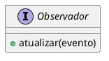

# 1.3. Iniciativas Extras (Padrões de Projeto)

## Descrição

Esta página registra as iniciativas realizadas pela equipe que vão além dos artefatos mínimos exigidos pela Entrega 03, apresentando os comprobatórios que evidenciam cada realização.

## Iniciativas

### 1. Suporte a diagramas PlantUML na documentação

**Responsável:** [Caio Alexandre](https://github.com/bitterteriyaki) · **SubEquipe_03** · 14/10/2026

Foi adicionado ao site de documentação o plugin [docsify-plantuml](https://www.npmjs.com/package/docsify-plantuml), que passa a renderizar blocos de código marcados como `plantuml` diretamente como diagramas UML. A iniciativa dá continuidade à adotada na [Entrega 02](https://unbarqdsw2026-2-turma01.github.io/RepositorioTemplateEntrega2-TabNews-Forum/#/Base/1.3.IniciativasExtras), na qual o recurso foi introduzido.

A motivação é metodológica. Diagramas mantidos como imagens binárias (`.png`) exportadas de ferramentas externas trazem três limitações para uma entrega avaliada por rastreabilidade:

1. **O histórico do Git não registra a evolução do artefato.** O `diff` de um arquivo binário informa apenas que a imagem mudou, não *o que* mudou nela;
2. **A autoria de uma alteração pontual não fica evidente.** Corrigir um relacionamento exige reexportar a imagem inteira, e a contribuição se torna indistinguível de uma substituição completa do diagrama;
3. **O arquivo-fonte precisa ser versionado separadamente** do artefato publicado, criando o risco de divergência entre os dois.

Com o PlantUML, o código-fonte do diagrama passa a ser o próprio documento versionado: cada alteração aparece linha a linha no histórico, com autor e data. Nesta entrega, o recurso é especialmente útil para manter a modelagem dos padrões GoF alinhada ao código implementado, já que ambos evoluem juntos no mesmo repositório.

**Uso:**

````markdown

````

**Observação:** a renderização ocorre no site publicado (GitPages) e no servidor local. A visualização de arquivos `.md` pela interface do GitHub não executa o plugin e exibirá apenas o bloco de código — as apresentações devem ser feitas pelo GitPages.

**Comprobatórios:** configuração em [`docs/index.html`](https://github.com/UnBArqDsw2026-2-Turma01/RepositorioTemplateEntrega3-TabNews-Forum/blob/main/docs/index.html).

### 2. Padronização do ambiente de desenvolvimento local

**Responsável:** [Caio Alexandre](https://github.com/bitterteriyaki) · **SubEquipe_03** · 14/10/2026

Foi adicionado um arquivo `mise.toml` na raiz do repositório, fixando as versões das ferramentas necessárias para executar o site de documentação localmente e padronizando o comando de execução entre os integrantes.

```bash
mise install     # provisiona Node.js e pnpm nas versões fixadas
mise run dev     # inicia o site em http://localhost:3000
mise run open    # inicia o site e o abre no navegador padrão
```

A configuração não introduz `package.json`, arquivo de lock ou diretório de dependências na raiz do repositório: o `docsify-cli` é obtido e executado sob demanda via `pnpm dlx`, preservando o repositório como um projeto de documentação. O Node.js fixado também atende aos exemplos de código das subequipes que utilizam JavaScript.

**Comprobatórios:** arquivo [`mise.toml`](https://github.com/UnBArqDsw2026-2-Turma01/RepositorioTemplateEntrega3-TabNews-Forum/blob/main/mise.toml) na raiz do repositório.

## Histórico de Versões

| Versão | Data | Descrição | Autor(es) | Revisor(es) | Detalhe da Revisão |
|:------:|:----:|:----------|:----------|:------------|:-------------------|
| 1.0 | 14/10/2026 | Criação do documento e registro das iniciativas de suporte a PlantUML e de padronização do ambiente local. | [Caio Alexandre](https://github.com/bitterteriyaki) | [Arthur Fernandes](https://github.com/arthurfernandesj) | Inclusão da configuração do plugin docsify-plantuml, com a justificativa metodológica de rastreabilidade, e da configuração do mise para execução local do site. |

<p align="center">Tabela 1: Histórico de Versões.</p>
