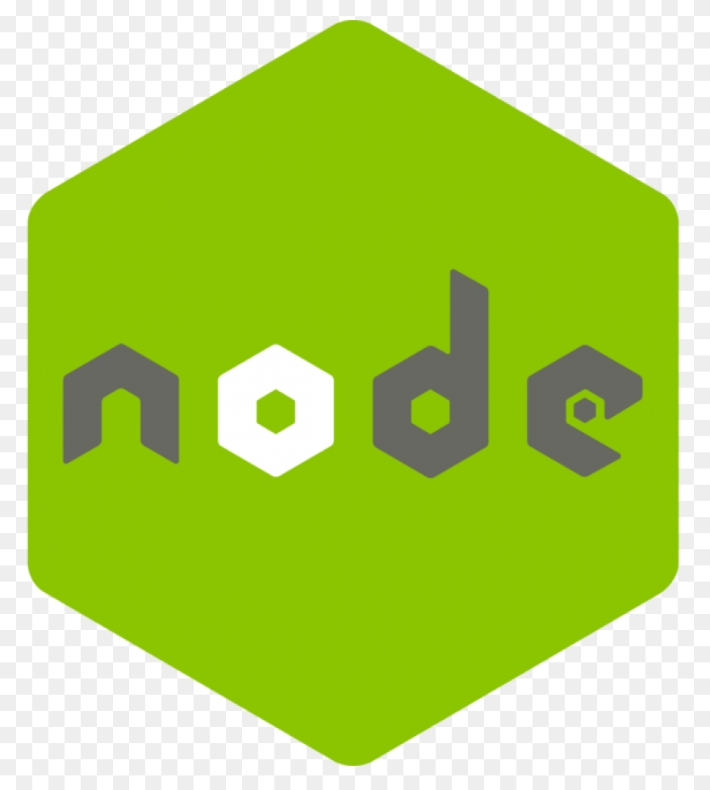

# Ferramentas

## 1. Introdução

Com o objetivo de assegurar maior organização, eficiência na comunicação e qualidade na produção dos artefatos durante o desenvolvimento do projeto, foi elaborado um levantamento das principais ferramentas utilizadas pela equipe na Entrega 3 da disciplina de Arquitetura e Desenho de Software. Essa etapa tem como foco o estudo, a modelagem, a implementação e a documentação dos padrões de projeto GoF (Gang of Four), contemplando as categorias criacionais, estruturais e comportamentais.

As ferramentas foram utilizadas para apoiar a comunicação entre os integrantes, a elaboração de diagramas, a implementação e execução de exemplos de código, a realização de testes automatizados, o controle de versão e a organização da documentação disponibilizada no GitHub Pages.

A Tabela 2 apresenta as principais ferramentas utilizadas durante a execução da entrega, acompanhadas de suas respectivas finalidades.

## 2. Participantes

Os integrantes do grupo contribuíram para o desenvolvimento dos artefatos da Entrega 3, utilizando as ferramentas conforme as atividades realizadas. Os participantes estão apresentados na tabela a seguir, em ordem alfabética.

<strong>Tabela 1: Participantes do projeto</strong>

| Aluno | GitHub |
|---|---|
| Arthur Fernandes Silva de Jesus | [@arthurfernandesj](https://github.com/arthurfernandesj) |
| Caio Alexandre Ornelas Silva | [@bitterteriyaki](https://github.com/bitterteriyaki) |
| Giovana de Souza Fontes | [@GiovanaFontesS](https://github.com/GiovanaFontesS) |
| Guilherme Moura da Silva Neto | [@Guilherme-Moura](https://github.com/Guilherme-Moura) |
| Isaac Menezes Pereira | [@pratamz250](https://github.com/pratamz250) |
| João Pedro Sampaio Maciel | [@jopesmp](https://github.com/jopesmp) |
| Leonardo Fachinello Bonetti | [@LeoFacB](https://github.com/LeoFacB) |
| Luciano Alves do Brasil Schindel Machado | Não informado |
| Pablo Rodrigues Lima | [@Pablo-R-L](https://github.com/Pablo-R-L) |
| Pedro Ramos Sousa Reis | [@PedroRSR](https://github.com/PedroRSR) |

## 3. Ferramentas

<strong>Tabela 2: Ferramentas utilizadas na Entrega 3</strong>

<table>
  <thead>
    <tr>
      <th align="center">Logo</th>
      <th align="center">Ferramenta</th>
      <th align="center">Finalidade</th>
    </tr>
  </thead>
  <tbody>
    <tr>
      <td align="center" width="40%">
        
      </td>
      <td align="center">ChatGPT</td>
      <td align="center">Apoio à consulta de dúvidas, à compreensão dos conceitos relacionados aos padrões de projeto e à revisão de textos e artefatos.</td>
    </tr>
    <tr>
      <td align="center">
        
      </td>
      <td align="center">Docsify</td>
      <td align="center">Criação, organização e navegação pelas páginas de documentação do projeto.</td>
    </tr>
    <tr>
    <tr>
      <td align="center">
        
      </td>
      <td align="center">GitHub</td>
      <td align="center">Hospedagem do repositório, colaboração entre os integrantes, gerenciamento do histórico de alterações e publicação da documentação pelo GitHub Pages.</td>
    </tr>
    <tr>
      <td align="center">
        
      </td>
      <td align="center">Node.js</td>
      <td align="center">Ambiente de execução JavaScript utilizado para executar os exemplos de implementação dos padrões de projeto e os testes automatizados.</td>
    </tr>
    <tr>
      <td align="center">
        
      </td>
      <td align="center">Visual Studio Code</td>
      <td align="center">Edição e organização dos arquivos JavaScript, dos testes automatizados e da documentação do projeto.</td>
    </tr>
  </tbody>
</table>

<strong>Fonte: Elaborado pelos autores (2026).</strong>

## 4. Aplicação das ferramentas no desenvolvimento

As ferramentas foram empregadas de acordo com as necessidades das atividades realizadas durante a Entrega 3.

Na documentação, o Docsify foi utilizado para organizar e disponibilizar os artefatos em páginas navegáveis, enquanto o GitHub Pages permitiu sua publicação. O Git e o GitHub apoiaram o controle de versão, o registro das contribuições e a colaboração entre os integrantes.

Na implementação dos padrões de projeto, o Visual Studio Code foi utilizado para editar e organizar os arquivos de código-fonte. O Node.js possibilitou executar os exemplos em JavaScript e os testes automatizados.

Na implementação do padrão Builder, por exemplo, foram desenvolvidos os arquivos `Publicacao.js`, `PublicacaoBuilder.js` e `index.js`, acompanhados do arquivo `PublicacaoBuilder.test.js`, utilizado para verificar o comportamento da implementação por meio de testes automatizados.

O ChatGPT foi utilizado como ferramenta de apoio para esclarecer dúvidas, compreender conceitos relacionados aos padrões de projeto e auxiliar na organização e revisão dos artefatos. As sugestões foram consideradas de acordo com as necessidades do projeto, mantendo sob responsabilidade dos integrantes a análise e as decisões técnicas.

## 5. Referências Bibliográficas

> 1. **OPENAI.** ChatGPT. Disponível em: <https://openai.com/index/chatgpt/>. Acesso em: 17 out. 2026.

> 2. **DOCSIFY.** Docsify. Disponível em: <https://docsify.js.org/>. Acesso em: 17 out. 2026.

> 3. **GITHUB.** GitHub Docs. Disponível em: <https://docs.github.com/pt>. Acesso em: 17 out. 2026.

> 4. **NODE.JS.** Node.js. Disponível em: <https://nodejs.org/>. Acesso em: 17 out. 2026.

> 5. **MICROSOFT.** Visual Studio Code. Disponível em: <https://code.visualstudio.com/>. Acesso em: 17 out. 2026.

## 6. Histórico de Versões

| Versão | Data | Descrição | Autor(es) | Revisor(es) | Detalhe da Revisão |
|:---:|:---:|---|---|---|---|
| 1.0 | 17/10/2026 | Criação da documentação das ferramentas utilizadas na Entrega 3, contemplando documentação, implementação, testes e controle de versão dos padrões de projeto GoF. | [Arthur Fernandes](https://github.com/arthurfernandesj) | [Giovana de Souza Fontes](https://github.com/GiovanaFontesS) | Primeira versão do documento, encaminhada para revisão da organização, clareza e adequação das informações ao projeto. |