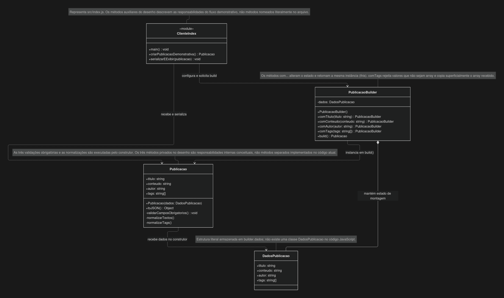
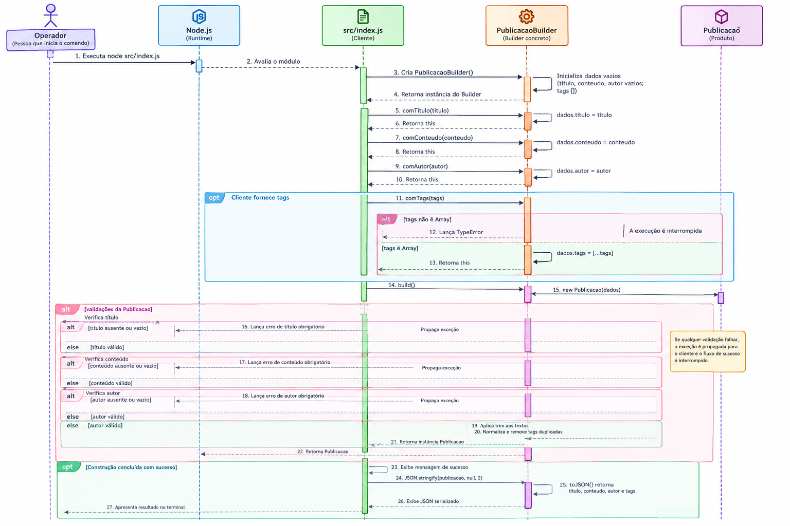
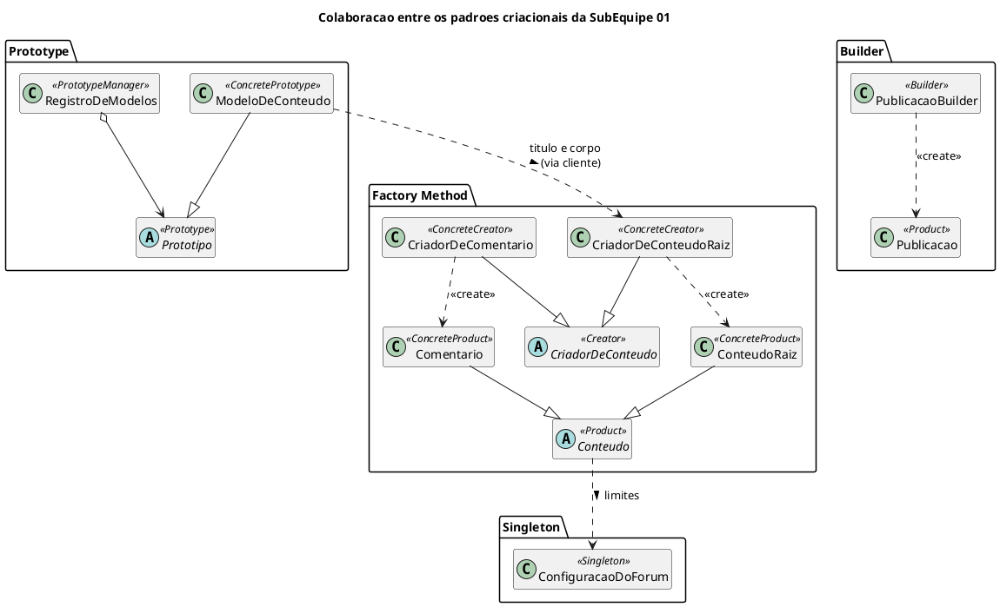
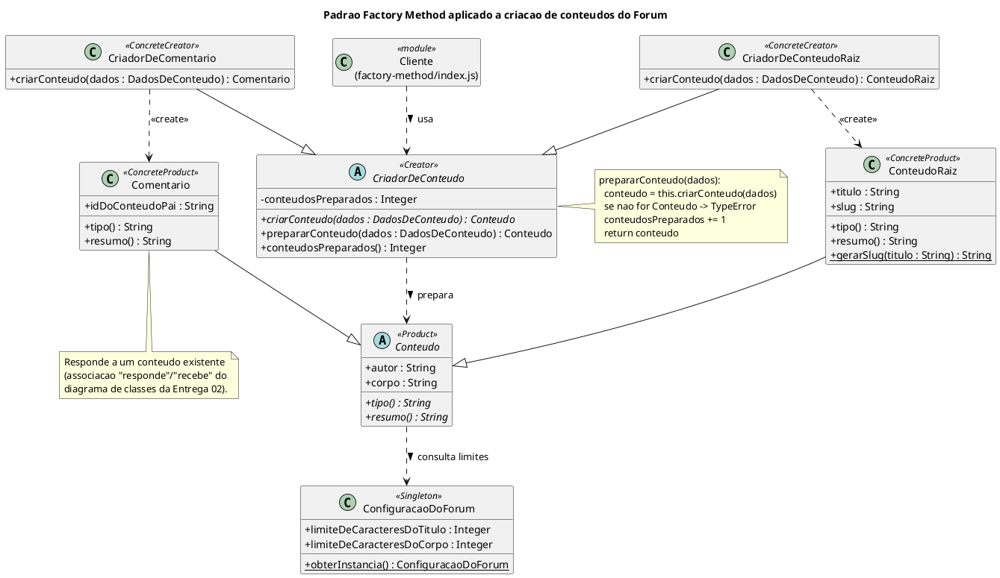
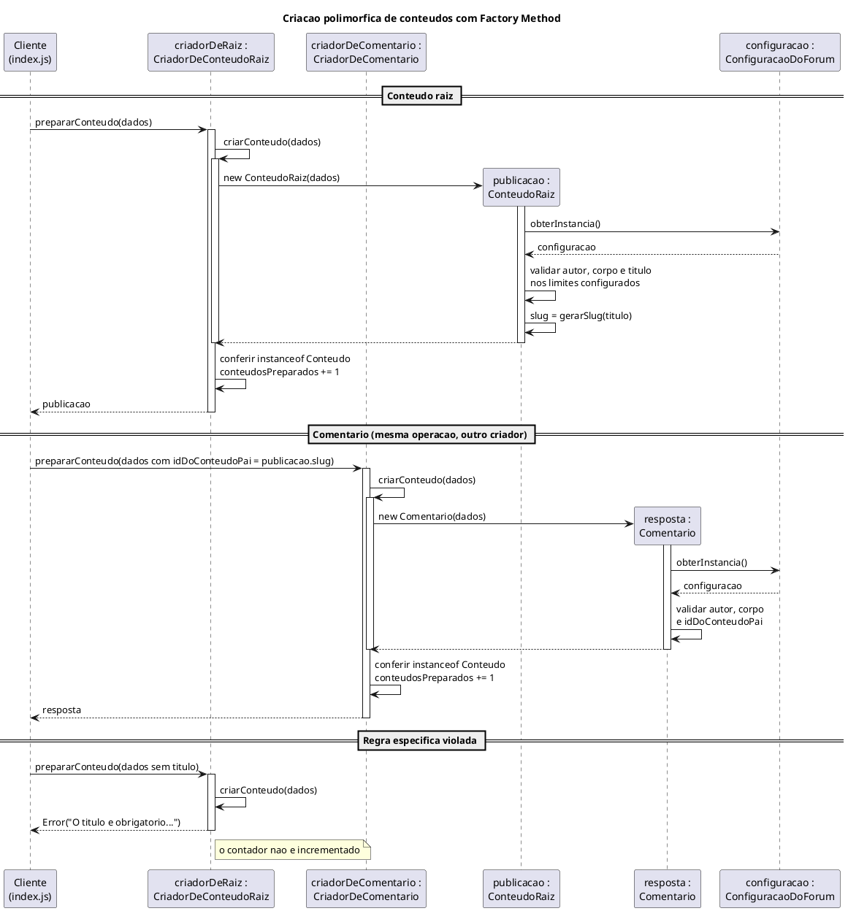
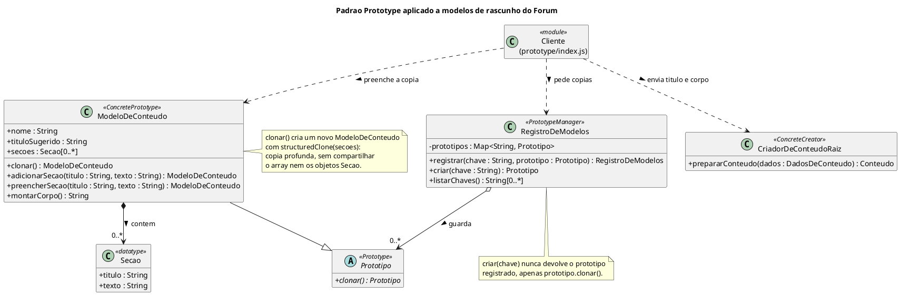
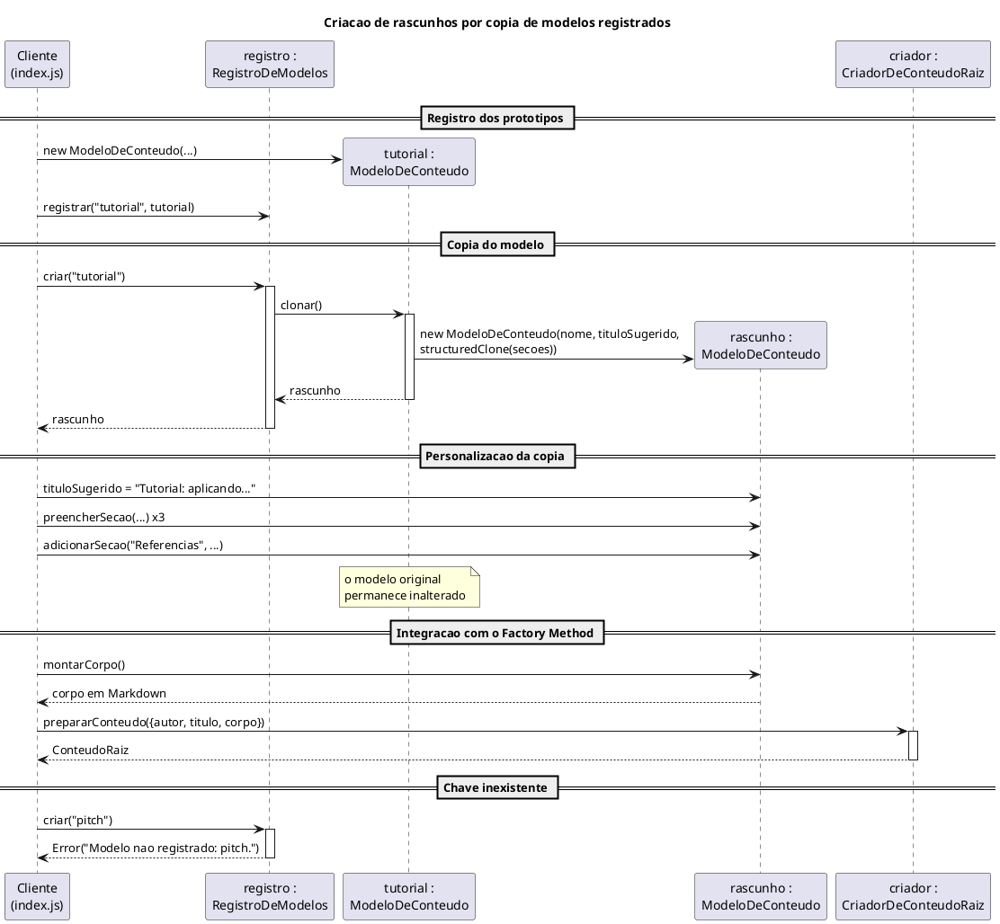
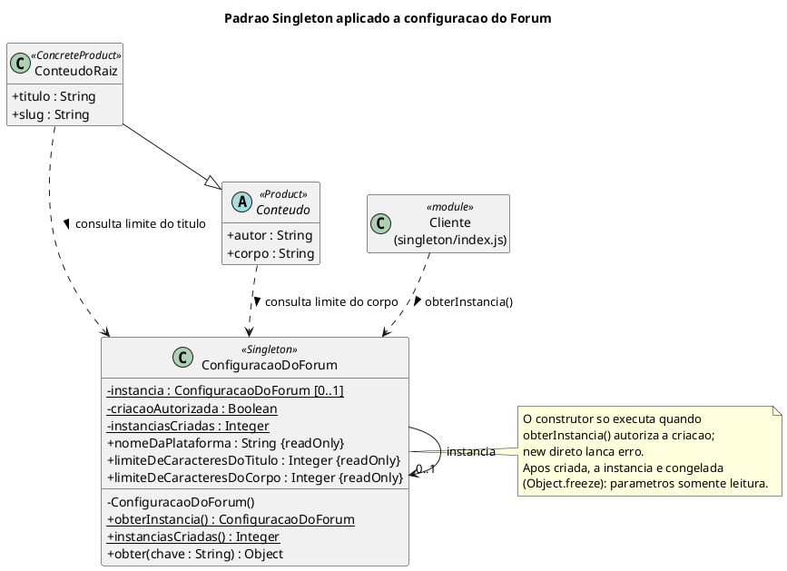
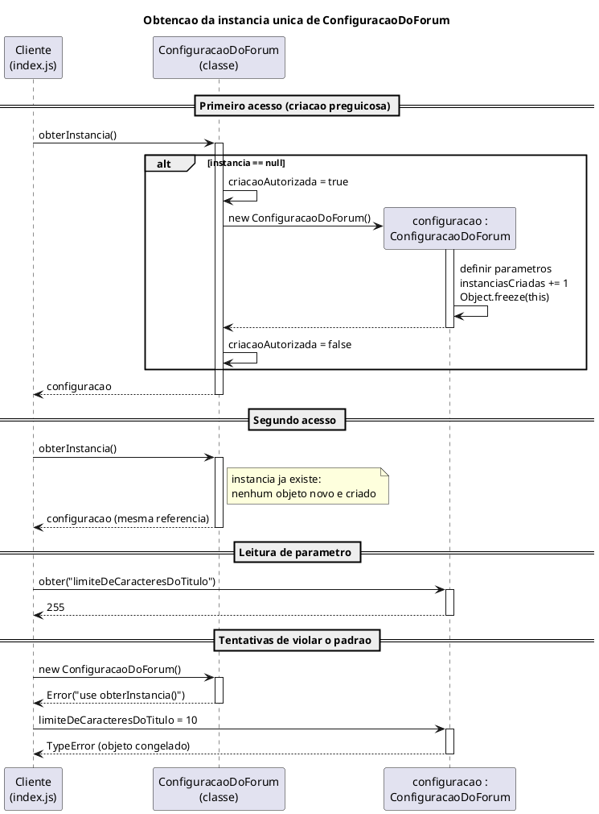

# 2. Modelagem

## 1. Introdução

Este documento modela a implementação demonstrativa do padrão criacional GoF **Builder** aplicada à construção de uma publicação no contexto do Projeto Fórum TabNews. A modelagem descreve o código que está disponível na SubEquipe 01: `src/PublicacaoBuilder.js`, `src/Publicacao.js`, `src/index.js` e `test/PublicacaoBuilder.test.js`.

A solução permite que o cliente configure título, conteúdo, autor e tags por chamadas nomeadas e encadeáveis. Ao chamar `build()`, o Builder entrega os dados à classe `Publicacao`; o construtor do produto valida os campos obrigatórios, normaliza os textos e prepara as tags. O exemplo termina com a serialização e a exibição dos dados no terminal.

O cenário é inspirado na criação de publicações de um fórum, mas os componentes são executados em memória e não se comunicam com o sistema real do TabNews. O autor é uma string demonstrativa; não há autenticação, persistência, publicação efetiva, moderação ou cálculo de TabCoins. Portanto, o processo modelado termina na criação e apresentação de um objeto JavaScript.

A seção 9 apresenta a modelagem dos padrões **Factory Method**, **Prototype** e **Singleton**, também implementados pela SubEquipe 01, com Diagramas de Classes e de Sequência em PlantUML e rastreabilidade com a modelagem da Entrega 02.

O relatório mantém as três figuras que já faziam parte da documentação e acrescenta fontes editáveis mais completas em Mermaid. As fontes podem ser copiadas para um editor compatível, como Mermaid Live Editor, e exportadas como imagem para substituir as figuras quando a equipe concluir a revisão visual. O código Mermaid também pode ser guardado em um bloco de código no Notion; para renderizá-lo como figura, use a opção de incorporação ou imagem disponível no fluxo de trabalho adotado pela equipe.

## 2. Escopo e participantes

O padrão Builder separa a configuração gradual de um objeto da criação do produto final. Na implementação atual, há três participantes principais:

| Papel no cenário | Elemento concreto | Responsabilidade e limite |
|:---|:---|:---|
| Cliente | `src/index.js` | Instancia `PublicacaoBuilder`, configura os dados, chama `build()` e imprime a representação JSON. Não é um serviço do Fórum nem uma interface web. |
| Builder concreto | `PublicacaoBuilder` | Mantém o estado temporário em `dados`, disponibiliza os métodos `comTitulo`, `comConteudo`, `comAutor`, `comTags` e `build`. Não valida os campos textuais. |
| Produto | `Publicacao` | Recebe os dados, valida título, conteúdo e autor, normaliza os textos e tags e fornece `toJSON()`. |

Não há `Builder` abstrato, hierarquia de Builders nem Director nesta versão dos arquivos-fonte. O Director é opcional no padrão e não deve aparecer como componente executado enquanto não houver uma classe implementada no código. Um Actor chamado “Usuário” pode aparecer em uma sequência para representar quem inicia o comando no terminal, mas ele não corresponde a uma classe do sistema.

## 3. Diagrama de Classes UML

### 3.1 Figura existente

A figura abaixo é mantida como registro da versão anterior do diagrama. Ela apresenta os três participantes principais, mas não mostra alguns detalhes da implementação: assinatura dos parâmetros de `Publicacao`, tipos mais precisos, comportamento de cópia e validação, operações de normalização e serialização, nem os retornos de cada método encadeável. A fonte Mermaid da seção seguinte expande esses pontos.

  

  <strong>Figura 1 — Diagrama de classes original, mantido para preservar o artefato da equipe.</strong> 
  Fonte: elaboração da SubEquipe 01.

### 3.2 Fonte ampliada do diagrama de classes

O diagrama abaixo mostra as classes e operações observáveis no código. As dependências tracejadas indicam uso/criação, não herança. `PublicacaoBuilder` possui um estado de configuração `dados`; `build()` usa esse estado para criar um novo produto. O desenho também distingue o módulo cliente das classes de domínio.

  

  <strong>Figura 2 — Diagrama de classes ampliado, preservado como imagem local da equipe.</strong> 
  Fonte: elaboração da SubEquipe 01.

**Nota de fidelidade UML:** `ClienteIndex` representa o módulo `src/index.js` e não uma classe JavaScript. A propriedade `dados` é um objeto literal, não uma classe própria. Validação e normalização são executadas no construtor de `Publicacao`, sem métodos privados separados. As notas UML detalham essas responsabilidades sem acrescentar participantes inexistentes.

### 3.3 Interpretação e relações

- **Cliente → Builder (dependência):** o cliente importa e instancia `PublicacaoBuilder`, invoca seus métodos e depende de sua API para montar o objeto.
- **Builder → dados temporários:** `dados` é um objeto literal pertencente ao estado do Builder. A composição do diagrama indica que esse estado é mantido durante a montagem; não é um produto público nem uma classe concreta no código.
- **Builder → produto (dependência de criação):** `PublicacaoBuilder` importa a classe `Publicacao` e, em `build()`, executa `new Publicacao(this.dados)`. O Builder não mantém uma referência permanente ao produto criado.
- **Cliente → produto (uso):** após `build()`, o cliente recebe o objeto e o serializa. A serialização JSON chama o método `toJSON()` do objeto, conforme a convenção de `JSON.stringify`.
- **Produto:** seus atributos são propriedades públicas e mutáveis no JavaScript atual. A classe valida e normaliza durante a construção, mas não congela o objeto depois disso.

Os métodos de configuração retornam `PublicacaoBuilder`, porque cada um executa `return this`. Essa relação de retorno explica o encadeamento, não a criação de um Builder novo em cada etapa. A chamada `build()` retorna `Publicacao`; cada chamada cria uma instância de produto nova.

## 4. Diagrama de Sequência UML

### 4.1 Figura existente

A figura anterior é mantida. Ela já mostra as mensagens centrais de configuração e construção, mas usa um único caminho simplificado: não evidencia o teste de tipo em `comTags`, a ordem das validações, o caminho de exceção, o retorno de `toJSON()` ou a chamada real a `JSON.stringify`.

  

  <strong>Figura 3 — Diagrama de sequência original, mantido para preservar o artefato da equipe.</strong> 
  Fonte: elaboração da SubEquipe 01.

### 4.2 Fonte ampliada da sequência

Este diagrama representa o cenário válido do `src/index.js` e inclui alternativas para tipo de tags inválido e campos obrigatórios inválidos. As mensagens de erro são retornos excepcionais: se uma exceção ocorre, o fluxo normal de construção e impressão não continua.

  

  <strong>Figura 4 — Diagrama de sequência ampliado do Builder, preservado como imagem local da equipe.</strong> 
  Fonte: elaboração da SubEquipe 01.

### 4.3 Leitura da sequência

1. O processo é iniciado fora do código da aplicação; o Runtime do Node.js avalia `index.js`.
2. O cliente cria um Builder e executa os quatro métodos de configuração. Cada método atualiza `dados` e devolve o mesmo Builder.
3. `comTags()` verifica o tipo antes de copiar a lista. Se receber valor diferente de array, lança `TypeError` imediatamente.
4. `build()` delega a criação ao construtor de `Publicacao`.
5. O construtor verifica título, conteúdo e autor nessa ordem. A primeira regra violada lança `Error` e interrompe a construção.
6. Com os campos válidos, o produto normaliza os textos e transforma as tags com `String(tag).trim()`, removendo vazias e duplicadas.
7. O cliente exibe a mensagem de sucesso e chama `JSON.stringify`. A serialização usa `toJSON()` e o JSON resultante é enviado ao terminal.

## 5. Diagrama de Atividades UML

### 5.1 Figura existente

A figura anterior é mantida como referência, mas o fluxo visual atual sugere uma verificação genérica de “campos obrigatórios” depois de `build()`. No código, não há uma operação de validação separada: as validações acontecem sequencialmente dentro do construtor `Publicacao`, e as tags podem lançar `TypeError` antes de `build()`.

  

  <strong>Figura 5 — Diagrama de atividades original, mantido para preservar o artefato da equipe.</strong> 
  Fonte: elaboração da SubEquipe 01.

### 5.2 Fonte ampliada das atividades

O fluxo abaixo explicita a preparação do Builder, a validação antecipada das tags, as três validações obrigatórias na ordem efetiva do construtor, a normalização e a saída. O caminho de erro termina sem apresentar JSON de sucesso.

Até o momento, não há uma segunda imagem de atividades ampliada entre os arquivos de `docs/images`. Por isso, esta seção mantém apenas o diagrama original da Figura 5 e não reutiliza a imagem de classes como se fosse uma atividade. A equipe pode substituir ou complementar a figura quando exportar uma nova versão do diagrama de atividades.

### 5.3 Regras e invariantes representadas

| ID | Regra derivada do código | Momento da aplicação | Efeito quando não atendida |
|:---|:---|:---|:---|
| RN01 | Título deve existir e conter caracteres diferentes de espaço. | Construtor de `Publicacao`, primeiro teste. | Lança `Error`; produto não é construído. |
| RN02 | Conteúdo deve existir e conter caracteres diferentes de espaço. | Construtor, depois da validação do título. | Lança `Error`; produto não é construído. |
| RN03 | Autor deve existir e conter caracteres diferentes de espaço. | Construtor, depois da validação do conteúdo. | Lança `Error`; produto não é construído. |
| RN04 | Tags configuradas pelo Builder precisam ser array. | `comTags()`, antes de `build()`. | Lança `TypeError` imediatamente. |
| RN05 | Espaços externos são removidos de título, conteúdo e autor. | Após as três validações. | Valores normalizados são armazenados no produto. |
| RN06 | Tags são convertidas para string, aparadas, valores vazios removidos e duplicatas eliminadas. | Durante o construtor de `Publicacao`. | A lista final guarda apenas tags normalizadas e únicas. |
| RN07 | `build()` cria uma instância de `Publicacao` nova a cada chamada bem-sucedida. | Ao executar `build()`. | Exceções do construtor são propagadas ao cliente. |
| RN08 | `toJSON()` define os campos da representação serializada. | Durante `JSON.stringify(publicacao, null, 2)`. | A saída inclui título, conteúdo, autor e tags conforme `toJSON()`. |

Essas regras são invariantes da demonstração e não regras completas de publicação do TabNews. O teste disponível comprova cinco cenários: construção válida, normalização de título/conteúdo e tags, rejeição de título ausente, rejeição de conteúdo ausente e rejeição de tags que não sejam array. Embora o código valide autor e o normalize, a suíte não tem teste específico para autor ausente nem uma asserção específica de normalização do autor. Também não há teste dedicado a `toJSON()` ou à independência entre chamadas sucessivas de `build()`.

## 6. Correspondência entre elementos e arquivos

| Elemento modelado | Localização | Evidência no código |
|:---|:---|:---|
| Cliente demonstrativo | `src/index.js` | Encadeia as chamadas do Builder, chama `build()` e imprime a serialização. |
| Builder concreto | `src/PublicacaoBuilder.js` | Mantém `dados`, configura os campos e instancia `Publicacao`. |
| Produto | `src/Publicacao.js` | Valida e normaliza os dados e define `toJSON()`. |
| Testes automatizados | `test/PublicacaoBuilder.test.js` | Verifica os cinco cenários descritos acima. |
| Runtime | Node.js | Executa o módulo e disponibiliza `JSON.stringify` e `console.log`; não é componente de domínio. |

## 7. Decisões e limitações da modelagem

### 7.1 Validação no produto

A validação de título, conteúdo e autor ocorre no construtor de `Publicacao`, não em métodos do Builder. Assim, qualquer caminho que instancie o produto diretamente continua sujeito às mesmas validações. O Builder organiza a entrada, mas não é a única barreira de validade.

### 7.2 Estado mutável do Builder

Os métodos `com...()` modificam o mesmo objeto `dados` e retornam `this`. O Builder não é reinicializado depois de `build()`. Se for reutilizado, os valores previamente configurados permanecem até serem substituídos; por isso, o uso demonstrado cria um Builder para cada publicação. Essa política deve ser considerada caso sejam adicionados fluxos com múltiplos produtos.

### 7.3 Cópia e mutabilidade do produto

`comTags()` faz cópia superficial do array recebido, e `Publicacao` cria outra lista ao normalizar as tags. Os campos do produto, porém, não são congelados e podem ser alterados após a construção. A demonstração não define imutabilidade nem cópia profunda, pois as tags finais são valores textuais e não há objetos aninhados no modelo atual.

### 7.4 Director não implementado

Não há arquivo `DiretorPublicacao.js` entre os arquivos atuais da SubEquipe 01. Portanto, não se modela uma classe Director nem receitas de tutorial/notícia como comportamento implementado. Caso o Director seja desenvolvido posteriormente, deverá ser adicionado ao código, aos testes e aos diagramas; até lá, pode ser descrito somente como possibilidade teórica.

### 7.5 Simplificações e não objetivos

- O diagrama não inclui classes de usuário autenticado, repositório, banco de dados ou serviço de publicação porque não existem neste recorte.
- Não se modelam respostas, estados de moderação, anexos, categorias ou avaliações, pois esses dados não estão no produto `Publicacao`.
- O construtor usa `trim()` para campos textuais, mas não declara validações explícitas de tipo, tamanho ou formato.
- Os testes existentes não comprovam integração web, persistência ou regras do produto TabNews.
- O Builder não publica conteúdo; ele devolve uma instância JavaScript em memória.

## 8. Como usar os códigos Mermaid para gerar as figuras

1. Copie todo o bloco Mermaid da figura desejada, começando em `classDiagram`, `sequenceDiagram` ou `flowchart TD`; não copie as cercas de Markdown.
2. Cole a fonte no Mermaid Live Editor ou em uma ferramenta que aceite Mermaid.
3. Confira se a ferramenta renderizou o diagrama sem erro e se os rótulos estão legíveis.
4. Exporte a figura em PNG ou SVG, conforme o formato aceito no fluxo do Notion e do repositório.
5. Para Notion, guarde também a fonte em um bloco de código para que o diagrama continue editável. Se o workspace não renderizar Mermaid diretamente, incorpore a visualização da ferramenta ou insira a imagem exportada.
6. Substitua as imagens anteriores somente depois de revisar a nova renderização; mantenha as figuras atuais até a equipe aprovar e adicionar as novas imagens.

As figuras antigas continuam vinculadas aos arquivos originais. Os links foram escritos com a URL estável do GitHub Pages para evitar que o caminho relativo seja resolvido a partir da rota do Docsify. Se o endereço público do projeto mudar, atualize o prefixo `https://unbarqdsw2026-2-turma01.github.io/RepositorioTemplateEntrega3-TabNews-Forum/` nas três referências.

## 9. Modelagem de Factory Method, Prototype e Singleton

> **Responsável:** [João Pedro S. Maciel](https://github.com/jopesmp)

Esta seção modela os três padrões criacionais que complementam o Builder. Para cada padrão são apresentados um **Diagrama de Classes**, que descreve a estrutura dos participantes, e um **Diagrama de Sequência**, que descreve a colaboração em tempo de execução. Os diagramas foram escritos em PlantUML, de modo que o código-fonte de cada diagrama é o próprio artefato versionado no repositório e é renderizado pelo GitPages (ver [Iniciativas Extras](/Base/1.3.IniciativasExtras.md)). Todos os elementos dos diagramas correspondem a classes, métodos e atributos existentes em `src/factory-method/`, `src/prototype/` e `src/singleton/`.

### 9.1 Rastreabilidade com a Entrega 02

Na [Modelagem Estática da Entrega 02](https://unbarqdsw2026-2-turma01.github.io/RepositorioTemplateEntrega2-TabNews-Forum/#/Base/Relatórios/SubEquipe_01/ModelagemEstatica), a SubEquipe 01 modelou as classes `Publicacao` (com `titulo`, `conteudo`, `status` e a operação `criar()`) e `Comentario` (com `conteudo`, a operação `criar()` e a autoassociação "responde"), além da associação "recebe" entre elas. Naquele diagrama, cada classe cria a si mesma, e não se define quem decide qual tipo de conteúdo deve ser instanciado. A modelagem desta entrega transfere essa decisão para os criadores do Factory Method:

| Elemento da Entrega 02 | Elemento desta modelagem | Papel no padrão |
|:---|:---|:---|
| `Publicacao` (`titulo`, `conteudo`) | `ConteudoRaiz` (`titulo`, `corpo`, `slug`) | *ConcreteProduct* do Factory Method |
| `Comentario` (`conteudo`) e associações "recebe"/"responde" | `Comentario` (`corpo`, `idDoConteudoPai`) | *ConcreteProduct* do Factory Method |
| Atributos comuns às duas classes (autor e texto) | `Conteudo` | *Product* abstrato |
| Operações `Publicacao.criar()` e `Comentario.criar()` | `CriadorDeConteudo.prepararConteudo()` e `criarConteudo()` | *Creator* e método-fábrica |
| — (nova funcionalidade) | `ModeloDeConteudo` e `RegistroDeModelos` | *ConcretePrototype* e gerenciador de protótipos |
| — (regras de tamanho não modeladas) | `ConfiguracaoDoForum` | *Singleton* |

Tabela 9.1: Correspondência entre a Entrega 02 e a modelagem dos padrões Factory Method, Prototype e Singleton.

O nome `ConteudoRaiz` foi adotado, em vez de `Publicacao`, para não colidir com a classe `Publicacao` do Builder (`src/Publicacao.js`) e para seguir o vocabulário do TabNews, em que publicações e comentários são conteúdos e uma publicação é o conteúdo sem pai.

### 9.2 Visão geral da colaboração

Figura 6: Visão geral dos padrões criacionais da SubEquipe 01. Fonte: SubEquipe 01 (2026).

A visão geral mostra os quatro padrões e as duas dependências entre eles: os produtos do Factory Method consultam os limites no Singleton, e o rascunho produzido pelo Prototype é transformado em `ConteudoRaiz` por meio do Factory Method. O Builder não depende dos demais.

### 9.3 Factory Method

#### 9.3.1 Diagrama de Classes

Figura 7: Diagrama de Classes do padrão Factory Method. Fonte: SubEquipe 01 (2026).

- **`CriadorDeConteudo`** (*Creator*): classe abstrata. O método-fábrica `criarConteudo()` aparece em itálico por ser abstrato; no JavaScript, a implementação padrão lança erro, e a própria classe não pode ser instanciada (`new.target`). `prepararConteudo()` é a operação concreta que usa o método-fábrica: ela depende apenas da abstração `Conteudo`, nunca das classes concretas.
- **`CriadorDeConteudoRaiz`** e **`CriadorDeComentario`** (*ConcreteCreator*): sobrescrevem somente `criarConteudo()`. A dependência `<<create>>` indica que cada criador concreto instancia exatamente um produto concreto.
- **`Conteudo`** (*Product*): classe abstrata com os atributos comuns e as operações abstratas `tipo()` e `resumo()`.
- **`ConteudoRaiz`** e **`Comentario`** (*ConcreteProduct*): implementam as regras específicas de cada tipo. `gerarSlug()` está sublinhado por ser estático.
- **`ConfiguracaoDoForum`**: aparece apenas com os membros usados pelos produtos. O papel de Singleton é detalhado na seção 9.5.
- **`DadosDeConteudo`**: não é uma classe. Representa o objeto literal `{ autor, titulo, corpo, idDoConteudoPai }` recebido pelos criadores.

#### 9.3.2 Diagrama de Sequência

Figura 8: Diagrama de Sequência da criação polimórfica de conteúdos. Fonte: SubEquipe 01 (2026).

1. **Conteúdo raiz.** O cliente chama `prepararConteudo()` no criador. O criador chama o próprio método-fábrica (automensagem `criarConteudo`), que instancia `ConteudoRaiz`. O produto consulta a configuração única, valida autor, corpo e título dentro dos limites e gera o slug. Ao final, o criador confere o tipo do retorno e incrementa seu contador.
2. **Comentário.** A mesma mensagem `prepararConteudo()` é enviada a outro criador e resulta em outro produto. O fluxo é idêntico até o ponto em que o método-fábrica decide a classe, o que evidencia a decisão de criação delegada à subclasse.
3. **Regra violada.** Sem título, o construtor de `ConteudoRaiz` lança erro; a exceção atravessa `criarConteudo()` e `prepararConteudo()`, e o contador não é incrementado.

### 9.4 Prototype

#### 9.4.1 Diagrama de Classes

Figura 9: Diagrama de Classes do padrão Prototype. Fonte: SubEquipe 01 (2026).

- **`Prototipo`** (*Prototype*): classe abstrata que declara `clonar()`.
- **`ModeloDeConteudo`** (*ConcretePrototype*): a relação com `Secao` é uma **composição**, pois as seções pertencem ao modelo e são copiadas junto com ele. Essa composição é o motivo de `clonar()` precisar de cópia profunda.
- **`Secao`**: estereótipo `<<datatype>>`, porque no código é um objeto literal `{ titulo, texto }`, não uma classe.
- **`RegistroDeModelos`** (gerenciador de protótipos): a relação com `Prototipo` é uma **agregação** com multiplicidade `0..*`, pois o registro guarda referências aos protótipos sem controlar a criação deles. O registro depende apenas da abstração `Prototipo`, e por isso aceita qualquer protótipo concreto.
- **Cliente**: depende do registro para obter cópias e do `CriadorDeConteudoRaiz` para transformar o rascunho em conteúdo.

#### 9.4.2 Diagrama de Sequência

Figura 10: Diagrama de Sequência da criação de rascunhos por cópia. Fonte: SubEquipe 01 (2026).

1. **Registro.** O cliente cria os modelos e os registra por chave.
2. **Cópia.** `criar("tutorial")` não devolve o modelo: o registro chama `clonar()`, e o modelo cria um novo objeto com cópia profunda das seções.
3. **Personalização.** As alterações são feitas apenas no rascunho. A nota sobre `tutorial` destaca que o protótipo permanece inalterado, o que a execução confirma ao gerar uma segunda cópia ainda vazia.
4. **Integração.** O rascunho gera o corpo em Markdown e é enviado ao `CriadorDeConteudoRaiz`, reaproveitando o Factory Method.
5. **Erro.** Uma chave não registrada resulta em erro, sem criação de objeto.

### 9.5 Singleton

#### 9.5.1 Diagrama de Classes

Figura 11: Diagrama de Classes do padrão Singleton. Fonte: SubEquipe 01 (2026).

- **`ConfiguracaoDoForum`** (*Singleton*): os membros estáticos (sublinhados) guardam a instância única, a autorização de criação e a contagem de instâncias criadas. O construtor aparece como **privado** (`-`), pois só executa quando `obterInstancia()` autoriza a criação. Os parâmetros têm a restrição `{readOnly}`, que corresponde ao `Object.freeze` aplicado ao final do construtor.
- **Autoassociação `instancia`** com multiplicidade `0..1`: representa a referência da classe para sua única instância, que é nula até o primeiro acesso.
- **Clientes**: `Conteudo` e `ConteudoRaiz` dependem da configuração para os limites, e o módulo de demonstração a usa diretamente.

#### 9.5.2 Diagrama de Sequência

Figura 12: Diagrama de Sequência da obtenção da instância única. Fonte: SubEquipe 01 (2026).

1. **Primeiro acesso.** O fragmento `alt` mostra a inicialização preguiçosa: somente quando `instancia` é nula, a classe autoriza a criação, instancia o objeto, congela-o e retira a autorização.
2. **Segundo acesso.** Nenhum objeto é criado, e a mesma referência é devolvida.
3. **Leitura.** O parâmetro é lido pela instância única.
4. **Violações.** O `new` direto falha porque a criação não está autorizada, e a escrita falha porque o objeto está congelado.

### 9.6 Regras modeladas

| ID | Regra | Componente | Teste que a verifica |
|:---|:---|:---|:---|
| FM01 | Cada criador concreto produz somente o seu tipo de conteúdo. | `CriadorDeConteudoRaiz`, `CriadorDeComentario` | `CriadorDeConteudoRaiz produz um ConteudoRaiz`; `CriadorDeComentario produz um Comentario` |
| FM02 | O cliente cria qualquer tipo de conteúdo pela mesma operação `prepararConteudo()`. | `CriadorDeConteudo` | `o cliente usa a mesma operação para qualquer criador` |
| FM03 | Criador e produto abstratos não podem ser instanciados. | `CriadorDeConteudo`, `Conteudo` | `classes abstratas não podem ser instanciadas` |
| FM04 | O método-fábrica deve devolver um `Conteudo`; caso contrário, `prepararConteudo()` lança `TypeError`. | `CriadorDeConteudo` | `rejeita método-fábrica que não devolve Conteudo` |
| FM05 | Conteúdo raiz exige título; comentário exige conteúdo pai. | `ConteudoRaiz`, `Comentario` | `aplica as regras específicas de cada produto` |
| FM06 | Título até 255 caracteres e corpo até 20.000, conforme a configuração única. | `Conteudo`, `ConteudoRaiz` | `usa os limites do Singleton de configuração` (título) |
| FM07 | O slug é gerado do título, sem acentos e com hifens. | `ConteudoRaiz` | `gera slug sem acentos a partir do título` |
| FM08 | O contador só aumenta quando a criação é concluída. | `CriadorDeConteudo` | `cada criador conta apenas os conteúdos que preparou` |
| PT01 | `clonar()` devolve um objeto novo com os mesmos dados. | `ModeloDeConteudo` | `clonar() cria um objeto novo com os mesmos dados` |
| PT02 | A cópia é profunda: não compartilha o array nem os objetos de seção. | `ModeloDeConteudo` | `a cópia é profunda e não compartilha as seções` |
| PT03 | O registro entrega apenas cópias, e alterar uma cópia não afeta as seguintes. | `RegistroDeModelos` | `o registro devolve cópias...`; `alterar uma cópia não afeta as cópias seguintes` |
| PT04 | Só aceita objetos `Prototipo` e rejeita chaves desconhecidas. | `RegistroDeModelos` | `o registro rejeita chave desconhecida e objeto que não é Prototipo` |
| PT05 | `Prototipo` é abstrato, e o modelo valida nome e seções. | `Prototipo`, `ModeloDeConteudo` | `Prototipo é abstrato e o modelo valida seus dados` |
| SG01 | A instância é criada somente no primeiro acesso. | `ConfiguracaoDoForum` | `não cria a instância antes do primeiro acesso` |
| SG02 | Todos os acessos devolvem a mesma instância. | `ConfiguracaoDoForum` | `acessos sucessivos devolvem a mesma instância` |
| SG03 | A criação direta com `new` é impedida. | `ConfiguracaoDoForum` | `impede a criação direta com new` |
| SG04 | Os parâmetros são somente leitura. | `ConfiguracaoDoForum` | `os parâmetros são somente leitura` |
| SG05 | Chaves de configuração desconhecidas são rejeitadas. | `ConfiguracaoDoForum` | `obter() devolve parâmetros existentes e rejeita chaves desconhecidas` |

Tabela 9.2: Regras modeladas e testes correspondentes.

O limite do corpo (FM06) é aplicado pelo código, mas a suíte testa explicitamente apenas o limite do título.

### 9.7 Correspondência entre elementos e arquivos

| Elemento modelado | Arquivo |
|:---|:---|
| `ConfiguracaoDoForum` | [`src/singleton/ConfiguracaoDoForum.js`](https://github.com/UnBArqDsw2026-2-Turma01/RepositorioTemplateEntrega3-TabNews-Forum/blob/main/docs/Base/Relat%C3%B3rios/SubEquipe01/src/singleton/ConfiguracaoDoForum.js) |
| `Conteudo`, `ConteudoRaiz`, `Comentario` | [`src/factory-method/Conteudo.js`](https://github.com/UnBArqDsw2026-2-Turma01/RepositorioTemplateEntrega3-TabNews-Forum/blob/main/docs/Base/Relat%C3%B3rios/SubEquipe01/src/factory-method/Conteudo.js) |
| `CriadorDeConteudo`, `CriadorDeConteudoRaiz`, `CriadorDeComentario` | [`src/factory-method/CriadorDeConteudo.js`](https://github.com/UnBArqDsw2026-2-Turma01/RepositorioTemplateEntrega3-TabNews-Forum/blob/main/docs/Base/Relat%C3%B3rios/SubEquipe01/src/factory-method/CriadorDeConteudo.js) |
| `Prototipo`, `ModeloDeConteudo`, `Secao` | [`src/prototype/ModeloDeConteudo.js`](https://github.com/UnBArqDsw2026-2-Turma01/RepositorioTemplateEntrega3-TabNews-Forum/blob/main/docs/Base/Relat%C3%B3rios/SubEquipe01/src/prototype/ModeloDeConteudo.js) |
| `RegistroDeModelos` | [`src/prototype/RegistroDeModelos.js`](https://github.com/UnBArqDsw2026-2-Turma01/RepositorioTemplateEntrega3-TabNews-Forum/blob/main/docs/Base/Relat%C3%B3rios/SubEquipe01/src/prototype/RegistroDeModelos.js) |
| Clientes das Figuras 8, 10 e 12 | `src/factory-method/index.js`, `src/prototype/index.js`, `src/singleton/index.js` |

### 9.8 Decisões de modelagem

- **Classes abstratas em vez de interfaces.** O JavaScript não possui interfaces. Por isso, `CriadorDeConteudo`, `Conteudo` e `Prototipo` são modeladas como classes abstratas, cuja abstração é garantida em tempo de execução com `new.target`, como faz a SubEquipe 03 com `Observador`.
- **Objetos literais como `<<datatype>>`.** `Secao` e `DadosDeConteudo` não são classes no código e não recebem comportamento nos diagramas.
- **Chamadas estáticas na sequência.** No Diagrama de Sequência do Singleton, a classe e a instância aparecem como linhas de vida separadas, para distinguir `obterInstancia()` (operação de classe) de `obter()` (operação de instância).
- **Fora do escopo.** Persistência, autenticação, status de publicação (`StatusPublicacao` da Entrega 02) e identificadores UUID não são modelados, pois não existem na demonstração. O `slug` do conteúdo raiz é usado como identificador do conteúdo pai no exemplo.

## 10. Considerações finais

A modelagem detalha a colaboração entre cliente, Builder e produto e explicita o percurso do estado temporário até a representação JSON. O diagrama de classes documenta os elementos e as dependências; o diagrama de sequência evidencia mensagens e retornos, incluindo exceções; o diagrama de atividades descreve decisões, ordem das validações e saídas.

As fontes dos diagramas refletem o código disponível e registram como elementos conceituais aquilo que não existe como classe ou método independente. A demonstração tem valor didático no domínio de publicações de fórum, mas não deve ser confundida com uma funcionalidade integrada à aplicação real do TabNews.

A modelagem da seção 9 completa o conjunto dos padrões criacionais implementados. Os diagramas de classes tornam os papéis do GoF visíveis por estereótipos, e os diagramas de sequência mostram o momento em que cada padrão atua: a delegação da criação ao método-fábrica, a cópia profunda feita pelo protótipo e a inicialização preguiçosa da instância única. A tabela de regras liga cada comportamento modelado a um teste automatizado, o que permite conferir a modelagem diretamente contra o código.

## 11. Referências

GAMMA, Erich; HELM, Richard; JOHNSON, Ralph; VLISSIDES, John. *Design Patterns: Elements of Reusable Object-Oriented Software*. Reading, MA: Addison-Wesley, 1994.

OBJECT MANAGEMENT GROUP (OMG). *OMG Unified Modeling Language (OMG UML)*. Disponível em: <https://www.omg.org/spec/UML/>. Acesso em: 19 out. 2026.

MERMAID. *Mermaid Documentation*. Disponível em: <https://mermaid.js.org/>. Acesso em: 19 out. 2026.

PLANTUML. *Class Diagram* e *Sequence Diagram*. Disponível em: <https://plantuml.com/>. Acesso em: 19 out. 2026.

SUBEQUIPE 01. *Modelagem Estática na Notação UML*. Entrega 02 — Projeto Fórum. Disponível em: <https://unbarqdsw2026-2-turma01.github.io/RepositorioTemplateEntrega2-TabNews-Forum/#/Base/Relatórios/SubEquipe_01/ModelagemEstatica>. Acesso em: 19 out. 2026.

## Histórico de Versões

| Versão | Data | Descrição | Autor(es) | Revisor(es) | Detalhe da Revisão |
|:---:|:---:|:---|:---|:---:|:---|
| 1.0 | 08/10/2026 | Criação inicial da modelagem do padrão Builder. | [Arthur Fernandes](https://github.com/arthurfernandesj) | [Giovana Fontes](https://github.com/GiovanaFontesS) | Versão inicial com diagrama de classes, participantes e fluxo de construção. |
| 1.1 | 08/10/2026 | Ampliação da modelagem e alinhamento com a implementação demonstrativa. | [Arthur Fernandes](https://github.com/arthurfernandesj) | [Giovana Fontes](https://github.com/GiovanaFontesS) | Inclusão dos diagramas de sequência e atividades, regras de validação, correspondência com os arquivos de código e referências. |
| 1.2 | 10/10/2026 | Adição de considerações sobre a aplicabilidade do padrão Builder. | [Giovana Fontes](https://github.com/GiovanaFontesS) | [Arthur Fernandes](https://github.com/arthurfernandesj) | Comparação com a construção tradicional e análise de manutenibilidade, extensibilidade e limitações. |
| 1.3 | 14/10/2026 | Adição de exemplos e modificação nas regras de negócio. | [João Pedro S. Maciel](https://github.com/jopesmp) | [Arthur Fernandes](https://github.com/arthurfernandesj) | Inclusão de exemplo teórico com Director e atualização das regras. |
| 1.4 | 19/10/2026 | Revisão detalhada dos diagramas e alinhamento da modelagem ao código atual. | [Arthur Fernandes](https://github.com/arthurfernandesj) | [Giovana Fontes](https://github.com/GiovanaFontesS) | Preservação das figuras anteriores, inclusão das fontes Mermaid ampliadas, detalhamento dos fluxos válidos e de erro e correção de descrições que não correspondiam aos arquivos disponíveis. |
| 1.5 | 19/10/2026 | Modelagem de Factory Method, Prototype e Singleton. | [João Pedro S. Maciel](https://github.com/jopesmp) | — | Inclusão da seção 9: rastreabilidade com a Entrega 02, visão geral, Diagramas de Classes e de Sequência em PlantUML para os três padrões, regras ligadas aos testes, correspondência com os arquivos e decisões de modelagem. |
