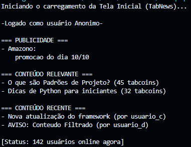

# 4. Execução

Esta seção apresenta os procedimentos necessários para executar a demonstração do padrão de projeto GoF Facade aplicado ao carregamento da Tela Inicial. São descritos os pré-requisitos, os comandos de execução, os resultados esperados, as validações e os critérios utilizados para verificar o comportamento da implementação.

A demonstração foi desenvolvida em Python e não depende de bibliotecas externas. O seu objetivo é verificar a orquestração de múltiplos serviços (postagens relevantes, postagens recentes e estatísticas) através de uma fachada única, consolidando os dados para a interface do cliente.

A implementação possui caráter didático e é independente do sistema real do Projeto Fórum (TabNews), não realizando persistência em base de dados nem integração com utilizadores reais.

## 1. Pré-requisitos

Para executar a demonstração, são necessários:

- Python versão 3.8 ou superior;
- Terminal aberto na raiz do projeto;
- Ficheiros da implementação organizados conforme a estrutura definida;
- Nenhuma dependência externa para a execução do programa principal.

A estrutura esperada do projeto é:

```text
projeto/
├── src/
│   ├── subsistemas.py
│   ├── tela_inicial_facade.py
│   └── main.py

```

Para verificar se o Python está instalado, execute no terminal:

```bash
python --version

```

*(Nota: Em alguns sistemas, pode ser necessário utilizar o comando `python3 --version`)*.

Caso o comando não seja reconhecido, será necessário instalar ou configurar o ambiente Python antes de continuar.

## 2. Executar a demonstração

Com o terminal aberto na pasta `src` (ou referenciando o caminho correto a partir da raiz do projeto), execute:

```bash
python main.py

```

O programa instancia a classe `TelaInicialFacade` e executa o método `carregar_dados()` para obter as informações unificadas, apresentando os resultados formatados no terminal.

### 2.1. Resultado esperado

Considerando a implementação apresentada nos ficheiros de código, a saída esperada é:

```text
Iniciando o carregamento da Tela Inicial (TabNews)...

-Logado como usuário Anonimo-

=== PUBLICIDADE ===
- Amazono:
    promocao do dia 10/10

=== CONTEÚDO RELEVANTE ===
- O que são Padrões de Projeto? (45 tabcoins)
- Dicas de Python para iniciantes (32 tabcoins)

=== CONTEÚDO RECENTE ===
- Nova atualização do framework (por usuario_c)
- AVISO: Conteudo Filtrado (por usuario_d)

[Status: 142 usuários online agora]

```

Os dados exibidos provêm de simulações internas nas classes de serviço (`ServicoPostagensRelevantes`, `ServicoPostagensRecentes` e `ServicoEstatisticas`) e são perfeitamente agregados pela Fachada.

**Importante:** esta saída representa o resultado esperado com base no código apresentado. A comprovação real deverá ser registada através de uma captura do terminal da equipa.

## 3. Executar os testes automatizados

1. Execute:

```bash
python -m unittest test_facade.py

```

*(Dica: Para uma saída mais detalhada, use a flag `-v`: `python -m unittest test_facade.py -v`)*

**Resultado Esperado no Terminal:**

```text
....
----------------------------------------------------------------------
Ran 4 tests in 0.003s

OK

```

### 3.1. Cenários de teste

Os testes devem verificar os seguintes comportamentos:

| Identificador | Cenário | Resultado esperado |
| --- | --- | --- |
| CT01 | Carregamento de dados com sucesso. | A Fachada devolve um dicionário com `sucesso: True` e todos os feeds populados. |
| CT02 | Falha num dos subsistemas. | A Fachada captura a exceção e devolve um dicionário com `sucesso: False` e a mensagem de erro. |
| CT03 | Independência do cliente. | A execução ocorre sem que o ficheiro de testes necessite de importar diretamente os serviços de subsistema. |

## 4. Critérios de validação

A implementação será considerada validada quando os seguintes critérios forem atendidos:

| Critério | Descrição | Verificação |
| --- | --- | --- |
| CV01 | Orquestração correta. | O método `carregar_dados()` invoca internamente as três classes de subsistema. |
| CV02 | Retorno consolidado. | A Fachada retorna um dicionário contendo o feed relevante, o feed recente e as informações de rodapé. |
| CV03 | Tratamento de exceções. | Qualquer falha na comunicação com os serviços resulta num retorno amigável com a flag `"sucesso": False`. |
| CV04 | Desacoplamento. | O ficheiro `main.py` não importa nem interage diretamente com o ficheiro `subsistemas.py`. |
| CV05 | Saída do programa. | Os dados da Tela Inicial são formatados e impressos corretamente no terminal. |

## 5. Evidências de execução

Esta seção deve reunir evidências que permitam verificar o funcionamento da implementação. As capturas devem ser produzidas durante a execução real dos comandos.

### 5.1. Execução do programa

Execute:

```bash
python main.py

```

Registe uma captura de ecrã que mostre o comando executado e a saída apresentada no terminal.

**Figura 1 — Execução da demonstração do padrão Facade.**

<p align="center">
  
</p>

<p align="center">
  <strong>Figura 1 — Comprovação de execução da implementação Facade.</strong><br>
  Fonte: elaboração da SubEquipe02.
</p>

### 5.2. Registo das evidências

| Evidência | Ficheiro ou captura | Resultado observado |
| --- | --- | --- |
| Execução do programa | A preencher após a execução | A preencher conforme a saída real. |
| Estrutura de Dicionário Retornada | A preencher após a execução | A preencher conforme a verificação realizada. |

## 6. Limitações da demonstração

A demonstração tem como finalidade apresentar o funcionamento do padrão de projeto Facade num cenário simplificado de leitura de dados para uma interface.

A implementação não contempla:

- Integração com a API real ou a base de dados do TabNews;
- Funcionalidades assíncronas para carregamento de publicações (`async`/`await`);
- Interface gráfica web (Frontend);
- Comunicação de rede (HTTP requests).

Desta forma, os resultados demonstram a orquestração do padrão didático, mas não substituem a arquitetura de rede da aplicação real.

## 7. Pontos de Vista dos Integrantes

Esta seção regista as perceções dos integrantes sobre a execução da demonstração, os procedimentos de verificação e os resultados observados.

### Isaac Menezes Pereira

O exemplo foi importante para compreender como o padrão Facade simplifica a interação entre diferentes subsistemas. A classe `TelaInicialFacade` centraliza a chamada dos serviços de publicações relevantes, publicações recentes e estatísticase permite que o programa principal obtenha todas as informações necessárias por meio de uma única interface. Essa organização facilita a manutenção do código e reduz o acoplamento entre o cliente e os componentes internos. Embora o exemplo utilize dados simulados e seja relativamente simples, ele demonstra bem a proposta do padrão e permite visualizar como essa abordagem poderia ser aplicada em um sistema real.

### Pablo Rodrigues Lima

Com a demonstração podemos verificar a aplicação do padrão Facade na tela inicial do TabNews, de acordo com o diagrama UML proposto. Os procedimentos contribuíram para avaliar a organização do código e a simplificação da interação entre as classes, assim podemos identificar se os objetivos foram devidamente alcançados.

### Pedro Ramos Sousa Reis

A etapa de execução permite relacionar a implementação do padrão Facade aos dados apresentados pelo programa. A verificação da saída no terminal ajuda a compreender como a fachada coordena os subsistemas de publicações relevantes, publicações recentes e estatísticas, reunindo as respostas em uma estrutura única para o cliente.

Por ser um padrão estrutural, o Facade se concentra em organizar a interação entre classes e simplificar o acesso a um subsistema. A execução e os testes permitem verificar se o cliente utiliza a interface simplificada da fachada e se o fluxo de carregamento e o tratamento de falhas correspondem ao comportamento documentado.

Na execução realizada, o programa concluiu sem erros e exibiu os feeds de publicações relevantes e recentes, além da quantidade de usuários online. Os quatro testes automatizados foram aprovados: além do carregamento bem-sucedido e do retorno consolidado, eles verificaram o tratamento de uma falha simulada em um subsistema, o desacoplamento do cliente e a formatação da saída no terminal. Não foi necessária nenhuma correção durante essa verificação.

## 8. Participação e Evidências

Esta seção regista as atividades relacionadas à documentação dos procedimentos de execução e à organização das evidências de verificação.

### Isaac Menezes Pereira

**Atividades desenvolvidas:**
| Descrição | Comprobatórios |
| --- | --- |
| Elaboração dos códigos para implementação do padrão Facade | [Commits no repositório](https://github.com/UnBArqDsw2026-2-Turma01/RepositorioTemplateEntrega3-TabNews-Forum/commits/docs/Sub02/?author=pratamz250&since=2026-10-15&until=2026-10-16) | 
| Estrutura básica para o GitHub Actions | [Commits no repositório](https://github.com/UnBArqDsw2026-2-Turma01/RepositorioTemplateEntrega3-TabNews-Forum/commits/docs/Sub02?author=pratamz250&since=2026-10-13&until=2026-10-13) |

### Pablo Rodrigues Lima

**Atividades desenvolvidas:**

- Atualização do resultado esperado
- Documentação da print do do terminal

**Evidências relacionadas:**

| Descrição | Comprobatórios |
| --- | --- |
| Fornecimento da print e atualização do resultado esperado | [Commits no repositório]() | 

### Pedro Ramos Sousa Reis

**Atividades desenvolvidas:**

- Organização dos procedimentos necessários para executar a demonstração em Python.
- Documentação dos comandos utilizados para iniciar a Tela Inicial.
- Definição dos critérios de validação do Facade.

**Evidências relacionadas:**

- Ficheiro `execução.md` 

## 9. Nível de Contribuição dos Integrantes

O nível de contribuição deve refletir as atividades efetivamente realizadas na elaboração e na verificação da implementação.

| Integrante | Atividades relacionadas | Nível de contribuição | Justificativa |
| --- | --- | --- | --- |
| Isaac Menezes Pereira | A Preencher | 33,33% | A classificação deve considerar as atividades efetivamente realizadas na subequipa 02. |
| Pablo Rodrigues Lima | A Preencher | 33,33% | A classificação deve considerar as atividades efetivamente realizadas na subequipa 02. |
| Pedro Ramos Sousa Reis | Organização da documentação de execução. | 33,33% | A classificação deve considerar as atividades efetivamente realizadas na subequipa 02. |

## 10. Referências

GAMMA, Erich et al. *Design Patterns: Elements of Reusable Object-Oriented Software*. Boston: Addison-Wesley, 1994.

PYTHON SOFTWARE FOUNDATION. *Python 3 Documentation*. Disponível em: [https://docs.python.org/3/](https://docs.python.org/3/). Acesso em: 15 out. 2026.

## 11. Histórico de Versões

| Versão | Data | Descrição | Autor(es) | Revisor(es) | Detalhe da Revisão |
| --- | --- | --- | --- | --- | --- |
| 1.0 | 15/10/2026 | Elaboração da documentação de execução do padrão Facade em Python. | [Pedro Ramos](https://github.com/PedroRSR) | [Pablo Rodrigues](https://github.com/Pablo-R-L) | Organização da documentação sobre pre-requisitos, execução da demonstração, execução dos testes, criterios, evidencias, ponto de vista, participações e nivel de contribuição. |
| 1.1 | 16/10/2026 | Adição do meu ponto de vista. | [Pedro Ramos](https://github.com/PedroRSR) | A preencher | A preencher | 
| 1.2 | 16/10/2026 | Adição de ponto de vista e contribuições | [Isaac Menezes](https://github.com/pratamz250) | — | — |
| 1.3 | 16/10/2026 | Adição de ponto de vista | [Pablo Rodrigues](https://github.com/Pablo-R-L) | — | — |
| 1.4 | 16/10/2026 | Adição da print de comprovação e atualização do resultado esperado | [Pablo Rodrigues](https://github.com/Pablo-R-L) | — | — |

