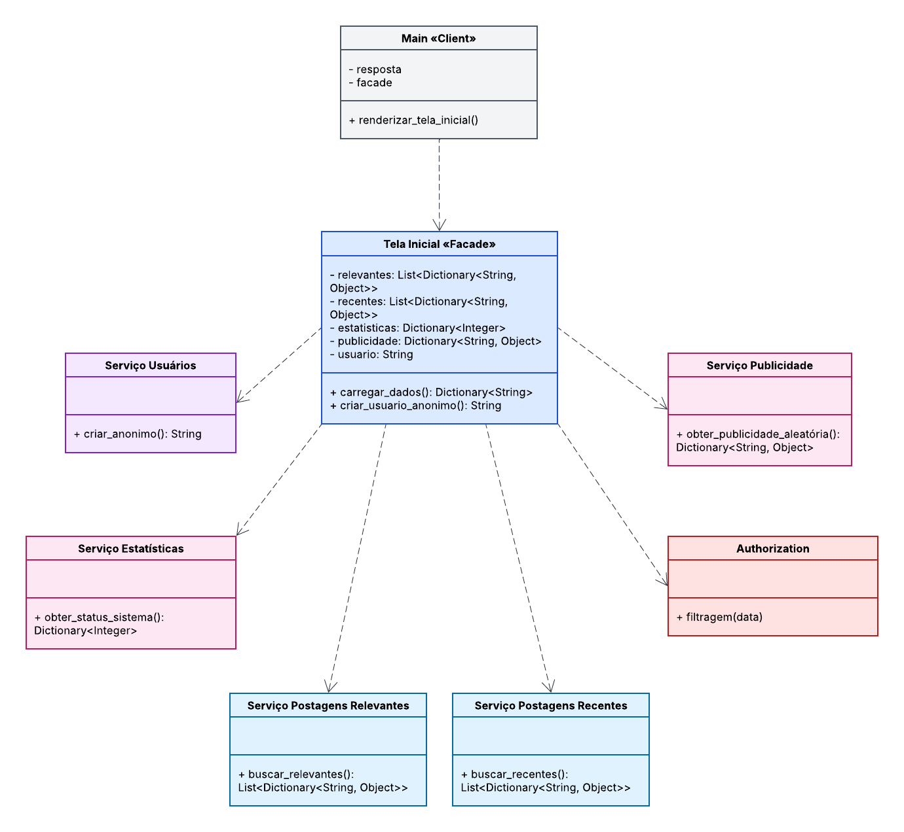

 # 2. Modelagem

## 1. Introdução

A modelagem do padrão GoF Facade representa a organização dos componentes que colaboram para carregar e exibir os dados da tela inicial do Projeto Fórum. A fachada `TelaInicialFacade`, implementada em Python, oferece ao cliente uma interface simplificada para coordenar diferentes subsistemas, sem exigir que ele conheça individualmente cada serviço.

Durante o carregamento, a fachada consulta os serviços de postagens relevantes e recentes, estatísticas e publicidade. Em seguida, aplica a filtragem de conteúdo às postagens e reúne os resultados em uma resposta com os feeds, os dados do rodapé e a publicidade. A fachada também disponibiliza a criação de um usuário anônimo em uma operação separada.

O arquivo `src/main.py` atua como cliente: solicita à fachada os dados da tela inicial e do usuário anônimo e apresenta os resultados no terminal, incluindo mensagens de erro quando uma operação falha. Os serviços definidos em `src/subsistemas.py` fornecem dados simulados para demonstrar a colaboração entre os componentes.

Esta modelagem corresponde à implementação demonstrativa em Python; os subsistemas não representam uma integração efetiva com os serviços ou o banco de dados do sistema principal do Projeto Fórum.

## 2. Diagrama de Classes UML

O diagrama de classes apresenta os componentes da solução, seus atributos, métodos e relacionamentos.

  

  <strong>Figura 1 — Diagrama de classes UML do padrão Facade aplicado ao carregamento da tela inicial.</strong> 
  Fonte: elaboração da SubEquipe02.  
  Resposáveis pelo diagrama: Pablo Rodrigues, Isaac Menezes e Pedro Ramos

### 2.1 Interpretação do diagrama

O diagrama apresenta o cliente, a fachada e seis subsistemas que colaboram para carregar os dados da tela inicial:

- **Main (Cliente):** corresponde a `src/main.py`. A função `renderizar_tela_inicial()` cria a fachada, solicita os dados e o usuário anônimo e exibe o resultado no terminal.
- **Tela Inicial (Facade):** corresponde à classe `TelaInicialFacade`, que oferece ao cliente as operações `carregar_dados()` e `criar_usuario_anonimo()`. A primeira coordena as consultas aos subsistemas, filtra as postagens e consolida os dados retornados; a segunda solicita a criação do usuário anônimo.
- **Serviço Postagens Relevantes:** fornece a lista de postagens relevantes por meio de `buscar_relevantes()`.
- **Serviço Postagens Recentes:** fornece a lista de postagens recentes por meio de `buscar_recentes()`.
- **Serviço Estatísticas:** retorna informações de status do sistema, como o número de usuários online, por meio de `obter_status_sistema()`.
- **Serviço Publicidade:** fornece os dados de uma publicidade por meio de `obter_publicidade_aleatoria()`.
- **Authorization:** aplica a filtragem de conteúdo às listas de postagens por meio de `filtragem(data)`.
- **Serviço Usuários:** cria e retorna um usuário anônimo por meio de `criar_anonimo()`.

O cliente depende da fachada, mas não precisa acessar diretamente os subsistemas. A `TelaInicialFacade`, por sua vez, depende dos serviços de postagens, estatísticas, publicidade, autorização e usuários para executar suas operações. Na implementação demonstrativa, os serviços retornam dados simulados.

## 3. Participantes do padrão Facade

O padrão Facade fornece uma interface unificada para um conjunto de subsistemas. Nesta implementação, `TelaInicialFacade` coordena os serviços necessários para montar os dados da tela inicial, enquanto o cliente interage diretamente apenas com a fachada.

### 3.1 Fachada concreta — `src/tela_inicial_facade.py`

A classe `TelaInicialFacade`, definida em `src/tela_inicial_facade.py`, mantém referências aos serviços de postagens relevantes e recentes, estatísticas, publicidade, autorização e usuários. Ela expõe duas operações ao cliente:

| Método | Responsabilidade | Retorno |
|---|---|---|
| `carregar_dados()` | Consulta os feeds, as estatísticas e a publicidade; aplica a filtragem aos dois feeds; consolida os resultados. | Dicionário com `sucesso` e, em caso de sucesso, `dados` contendo `feed_relevante`, `feed_recente`, `informacoes_rodape` e `publicidade`. |
| `criar_usuario_anonimo()` | Solicita ao serviço de usuários a criação de um usuário anônimo. | Dicionário com `sucesso` e, em caso de sucesso, `usuario`. |

As operações envolvem seus subsistemas em blocos de tratamento de exceções e comunicam falhas por meio de um dicionário com `sucesso: False` e uma mensagem em `erro`. Assim, o cliente recebe um resultado uniforme sem precisar coordenar cada serviço individualmente.

### 3.2 Subsistemas — `src/subsistemas.py`

Os subsistemas implementam as tarefas específicas delegadas pela fachada:

| Classe | Operação | Responsabilidade na demonstração |
|---|---|---|
| `ServicoPostagensRelevantes` | `buscar_relevantes()` | Retorna uma lista simulada de postagens relevantes. |
| `ServicoPostagensRecentes` | `buscar_recentes()` | Retorna uma lista simulada de postagens recentes. |
| `ServicoEstatisticas` | `obter_status_sistema()` | Retorna estatísticas simuladas, como usuários online e publicações do dia. |
| `ServicoPublicidade` | `obter_publicidade_aleatoria()` | Retorna dados simulados de uma publicidade. |
| `ServicoAutorizacao` | `filtragem(data)` | Percorre as postagens e substitui o título e o valor de tabcoins de conteúdos identificados como impróprios. |
| `ServicoUsuarios` | `criar_anonimo()` | Retorna a identificação simulada do usuário anônimo. |

Esses serviços representam subsistemas independentes do ponto de vista das responsabilidades. Na implementação demonstrativa, eles fornecem dados fixos; não consultam banco de dados, cache ou serviços externos.

### 3.3 Cliente — `src/main.py`

O cliente é a função `renderizar_tela_inicial()`, definida em `src/main.py`. Ela instancia `TelaInicialFacade`, solicita o carregamento dos dados e a criação do usuário anônimo, verifica os indicadores de sucesso e imprime no terminal a publicidade, os feeds e o número de usuários online. Se uma operação falhar, apresenta a mensagem de erro retornada pela fachada.

O cliente não instancia nem chama diretamente os subsistemas: essa coordenação fica concentrada na fachada. O código de apresentação permanece separado das tarefas de obtenção e filtragem dos dados.

## 4. Regras de negócio e comportamento modelado

A implementação demonstra o fluxo de carregamento da tela inicial e a colaboração entre a fachada e seus subsistemas. As regras abaixo descrevem o comportamento existente no código da SubEquipe 2:

| Identificador | Regra | Componente responsável |
|---|---|---|
| RN01 | O cliente solicita à fachada o carregamento dos dados, sem chamar diretamente os subsistemas. | `main.py` e `TelaInicialFacade` |
| RN02 | O carregamento consulta os feeds relevante e recente, as estatísticas e a publicidade. | `TelaInicialFacade.carregar_dados()` |
| RN03 | Antes de retornar os feeds, a fachada solicita a filtragem das postagens relevantes e recentes. | `TelaInicialFacade` e `ServicoAutorizacao.filtragem()` |
| RN04 | Na demonstração, títulos que contêm a palavra `improprio` são substituídos por `AVISO: Conteudo Filtrado` e têm seus tabcoins zerados. | `ServicoAutorizacao` |
| RN05 | Em caso de sucesso, os dados são retornados sob `dados`, com as chaves `feed_relevante`, `feed_recente`, `informacoes_rodape` e `publicidade`. | `TelaInicialFacade.carregar_dados()` |
| RN06 | Se ocorrer uma exceção durante o carregamento, a fachada retorna `sucesso: False` e a mensagem em `erro`. | `TelaInicialFacade.carregar_dados()` |
| RN07 | A criação do usuário anônimo é uma operação separada e retorna o usuário sob a chave `usuario`; em caso de exceção, retorna `sucesso: False` e `erro`. | `TelaInicialFacade.criar_usuario_anonimo()` |

Os serviços fornecem dados simulados em memória. Portanto, essas regras descrevem a demonstração e não definem validações ou políticas completas para uma aplicação em produção.

## 5. Correspondência entre modelagem e implementação

A tabela relaciona os elementos apresentados no diagrama e no fluxo descrito aos arquivos Python da demonstração:

| Elemento da modelagem | Arquivo | Implementação |
|---|---|---|
| Cliente | `src/main.py` | A função `renderizar_tela_inicial()` instancia a fachada, solicita os dados e o usuário anônimo e apresenta os resultados no terminal. |
| Fachada concreta | `src/tela_inicial_facade.py` | `TelaInicialFacade` coordena os serviços, filtra os feeds e consolida os dados; também expõe a operação de criação de usuário anônimo. |
| Subsistemas | `src/subsistemas.py` | Define os serviços de postagens relevantes, postagens recentes, estatísticas, publicidade, autorização e usuários. |
| Testes automatizados | `src/test_facade.py` | Verifica o carregamento e a consolidação dos dados, o tratamento de falha no carregamento, a criação do usuário anônimo, o desacoplamento do cliente e a saída no terminal. |

Essa correspondência mantém a modelagem alinhada aos componentes e às responsabilidades efetivamente presentes na implementação da SubEquipe 2.

Caso sejam adicionados novos atributos, métodos ou classes, os diagramas e as descrições deverão ser revisados.

## 6. Justificativa das decisões de modelagem

Os subsistemas foram separados de acordo com as responsabilidades necessárias para compor a tela inicial: obter postagens relevantes, obter postagens recentes, consultar estatísticas, fornecer publicidade, filtrar conteúdo e criar um usuário anônimo. Essa divisão permite demonstrar a colaboração entre serviços distintos sem atribuir à fachada a implementação de cada tarefa.

Os serviços de postagens relevantes e recentes foram modelados separadamente porque representam consultas com critérios diferentes. A implementação não exige uma classe-base comum para essas operações; mantê-las independentes torna explícito o papel de cada serviço nesta demonstração. A `TelaInicialFacade` concentra a coordenação e entrega ao cliente uma resposta consolidada, evitando que `main.py` conheça a sequência de chamadas internas.

O diagrama de classes foi escolhido para mostrar a estrutura dos componentes e suas dependências. As setas representam o uso dos serviços pela fachada e o uso da fachada pelo cliente, sem indicar herança.

## 7. Comparação entre a construção tradicional e o padrão Facade

Sem uma fachada, a função cliente precisaria instanciar ou acessar cada serviço, conhecer os métodos disponíveis, chamar as consultas na ordem adequada, encaminhar as postagens para filtragem e combinar os resultados antes de exibi-los. Isso aumentaria o conhecimento do cliente sobre os detalhes internos e concentraria nele tanto a apresentação quanto a coordenação dos subsistemas.

Com o padrão Facade, `renderizar_tela_inicial()` solicita o conjunto de dados a `TelaInicialFacade.carregar_dados()` e a criação do usuário a `TelaInicialFacade.criar_usuario_anonimo()`. A fachada coordena os serviços e organiza os dados em uma resposta uniforme. O cliente permanece responsável por interpretar o resultado e apresentá-lo, enquanto os detalhes de obtenção e filtragem ficam encapsulados na fachada e nos respectivos subsistemas.

Essa simplificação reduz o acoplamento do cliente com os serviços, mas não elimina as dependências internas da solução nem substitui a lógica específica de cada subsistema. A comparação descreve esta implementação demonstrativa, não uma medição de desempenho nem uma versão alternativa já implementada.

## 8. Aplicabilidade do padrão Facade no contexto do Fórum

No contexto do Fórum, a tela inicial precisa reunir informações de diferentes áreas, como feeds, publicidade, estatísticas e dados de usuário. Uma fachada é aplicável quando se deseja oferecer ao componente de apresentação uma entrada simples para coordenar essas operações, sem transferir a ele o conhecimento sobre cada serviço.

Na demonstração, `TelaInicialFacade` cumpre esse papel ao consolidar feeds, estatísticas e publicidade e ao fornecer uma operação separada para criar o usuário anônimo. Em uma aplicação real, a mesma ideia poderia ser utilizada para coordenar serviços conectados a fontes de dados efetivas.

## 9. Manutenibilidade, extensibilidade e limitações da solução

**Manutenibilidade e extensibilidade:** a separação por responsabilidade permite alterar a obtenção de um tipo de dado no serviço correspondente sem transferir sua implementação ao cliente. Novas informações para a tela poderiam ser adicionadas por meio de novos subsistemas e incorporadas à fachada e à resposta consolidada. A interface do cliente tende a permanecer estável enquanto as operações oferecidas pela fachada e o formato de retorno não mudarem.

**Limitações:** os subsistemas retornam dados fixos e não acessam banco de dados, cache ou serviços externos. A filtragem é uma regra ilustrativa baseada na presença de uma palavra no título e não representa uma política completa de moderação. O tratamento de falhas captura exceções de forma ampla e retorna mensagens em dicionários, sem distinguir os tipos de erro. Essas escolhas são suficientes para a demonstração do padrão, mas não representam as falhas no código usado em produção.

Portanto, a fachada simplifica o acesso do cliente, mas sua evolução requer manter sincronizados a interface, a estrutura da resposta, os subsistemas e a documentação. A inclusão de novas responsabilidades deve preservar a coesão da fachada, evitando que ela acumule regras que pertencem aos próprios serviços.

## 10. Considerações finais

A implementação demonstra o padrão GoF Facade aplicado à composição dos dados de uma tela inicial. `TelaInicialFacade` oferece operações de alto nível ao cliente e coordena serviços especializados para obter e filtrar postagens, consultar estatísticas, fornecer publicidade e criar um usuário anônimo.

A separação entre cliente, fachada e subsistemas torna explícitas as responsabilidades e reduz a necessidade do cliente conhecer os detalhes de cada serviço. Como os dados e as operações são simulados, a solução deve ser entendida como apenas um exemplo, e não como uma integração funcional ao sistema principal do Fórum. O diagrama e as descrições documentam essa implementação e devem ser atualizados caso sua estrutura ou seu comportamento sejam alterados.

## 11. Referências

GAMMA, Erich; HELM, Richard; JOHNSON, Ralph; VLISSIDES, John. *Design Patterns: Elements of Reusable Object-Oriented Software*. Reading, MA: Addison-Wesley, 1994.

OBJECT MANAGEMENT GROUP (OMG). *OMG Unified Modeling Language (OMG UML)*. Disponível em: https://www.omg.org/spec/UML/. Acesso em: preencher após consultar a documentação.

## Histórico de Versões

| Versão | Data | Descrição | Autor(es) | Revisor(es) | Detalhe da Revisão |
|:---:|:---:|---|---|---|---|
| 1.0 | 13/10/2026 | Criação inicial da modelagem do padrão Facade. | [Isaac Menezes](https://github.com/pratamz250) | [Pablo Rodrigues](https://github.com/Pablo-R-L) | Versão inicial com diagrama de classes, participantes e fluxo de construção. |
| 1.1 | 18/10/2026 | Preenchimento dos tópicos e fornecimento da print do modelo. | [Pablo Rodrigues](https://github.com/Pablo-R-L) | [Isaac Menezes](https://github.com/pratamz250) | A contribuição foi relevante pelo fato da imagem ser um dos requisitos do projeto. |
| 1.2 | 18/10/2026 | Remoção de tópicos desnecessários. | [Pedro Ramos](https://github.com/PedroRSR) | [Pablo Rodrigues](https://github.com/Pablo-R-L) | Remoção de tópicos não condizentes com nosso projeto |
| 1.3 | 18/10/2026 | Adição de informações dos tópicos 4 e 5. | [Pedro Ramos](https://github.com/PedroRSR) | [Pablo Rodrigues](https://github.com/Pablo-R-L) | Preenchimento dos tópicos 4 e 5 |