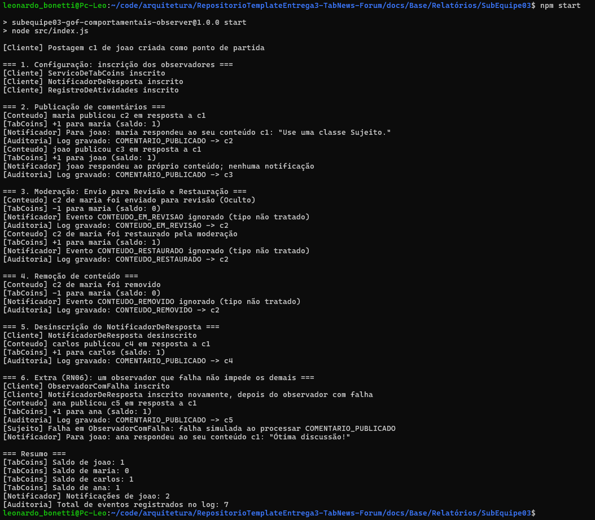
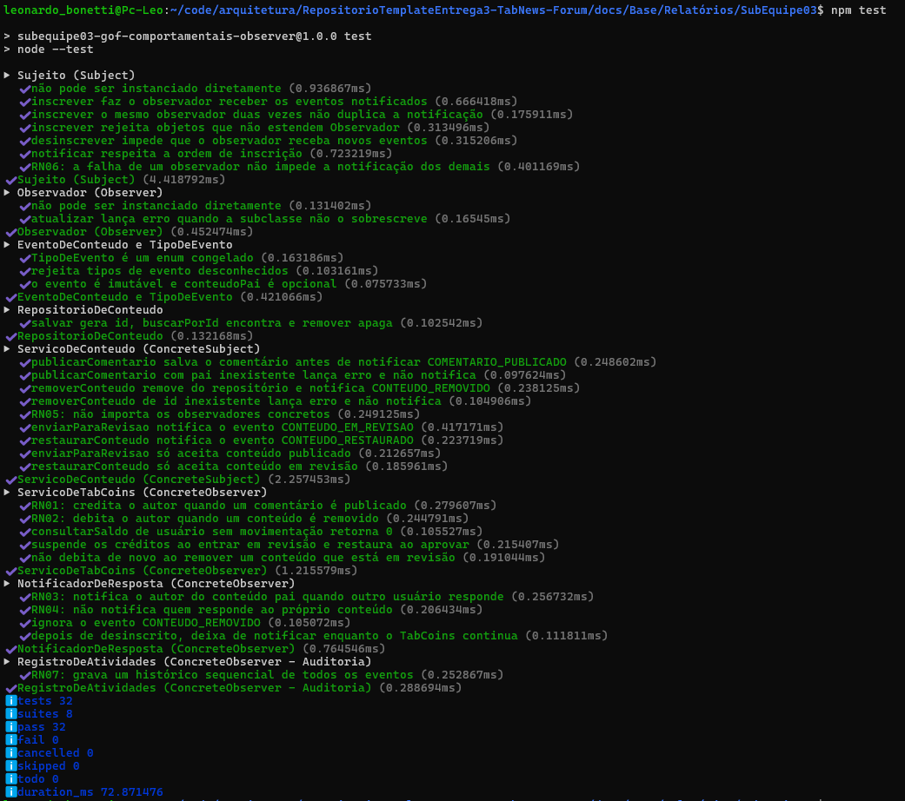

# 4. Execução

Esta seção apresenta os procedimentos necessários para executar a demonstração do padrão de projeto GoF Observer aplicado à gestão de eventos no ciclo de vida de conteúdos. São descritos os pré-requisitos, os comandos de execução, os resultados esperados, os testes automatizados e os critérios utilizados para verificar o comportamento da implementação.

A demonstração foi desenvolvida em JavaScript com Node.js e não depende de bibliotecas externas. Seu objetivo é verificar a viabilidade do padrão para garantir baixo acoplamento entre o serviço principal (`ServicoDeConteudo`) e os observadores (`ServicoDeTabCoins`, `NotificadorDeResposta` e `RegistroDeAtividades`).

A implementação possui caráter didático e independente do sistema real do Projeto Fórum, não realizando persistência em banco de dados real nem integração com usuários externos.

## 1. Pré-requisitos

Para executar a demonstração, são necessários:

- Node.js versão 18 ou superior, instalado diretamente ou por meio do `mise` (ver abaixo);
- terminal aberto na pasta `docs/Base/Relatórios/SubEquipe03/`, onde fica o `package.json`;
- arquivos da implementação organizados conforme a estrutura definida;
- nenhuma dependência externa para a execução do programa e dos testes.

A estrutura esperada do projeto é:

```text
docs/Base/Relatórios/SubEquipe03/
├── src/
│   ├── EventoDeConteudo.js
│   ├── NotificadorDeResposta.js
│   ├── Observador.js
│   ├── RegistroDeAtividades.js
│   ├── RepositorioDeConteudo.js
│   ├── ServicoDeConteudo.js
│   ├── ServicoDeTabCoins.js
│   ├── Sujeito.js
│   └── index.js
├── test/
│   └── observer.test.js
├── package.json
└── README.md
```

Para verificar se o Node.js e o npm estão instalados, execute:

```bash
node --version
npm --version
```

O comando `node --version` apresenta a versão instalada do Node.js. O comando `npm --version` verifica a disponibilidade do gerenciador de pacotes npm.

Caso os comandos não sejam reconhecidos, será necessário instalar ou configurar o Node.js antes de continuar.

Como alternativa, o repositório possui um arquivo `mise.toml` na raiz, que fixa a versão do Node.js utilizada pela equipe (ver [Iniciativas Extras](/Base/1.3.IniciativasExtras.md)). Com o [`mise`](https://mise.jdx.dev/) instalado, basta executar, na raiz do repositório:

```bash
mise install
```

O comando instala a versão definida, que passa a ser usada automaticamente dentro do repositório.

## 2. Executar a demonstração

Com o terminal aberto na pasta `docs/Base/Relatórios/SubEquipe03/`, execute:

```bash
npm start
```

O comando equivale a `node src/index.js`.

O programa instancia o serviço de conteúdos, configura a inscrição dos observadores e simula o fluxo completo do sistema, incluindo publicações, transições de moderação (revisão e restauração), remoção e falha de observadores.

Cada mensagem apresentada no terminal é prefixada pelo componente que a produziu (`[Cliente]`, `[Conteudo]`, `[TabCoins]`, `[Notificador]`, `[Auditoria]` e `[Sujeito]`), o que permite acompanhar a ordem em que os observadores são notificados.

### 2.1. Resultado obtido

A saída abaixo foi copiada do terminal após a execução real do comando em 17/10/2026, com o Node.js v24.20.0 e o npm 11.19.0:

```text
$ npm start

> subequipe03-gof-comportamentais-observer@1.0.0 start
> node src/index.js

[Cliente] Postagem c1 de joao criada como ponto de partida

=== 1. Configuração: inscrição dos observadores ===
[Cliente] ServicoDeTabCoins inscrito
[Cliente] NotificadorDeResposta inscrito
[Cliente] RegistroDeAtividades inscrito

=== 2. Publicação de comentários ===
[Conteudo] maria publicou c2 em resposta a c1
[TabCoins] +1 para maria (saldo: 1)
[Notificador] Para joao: maria respondeu ao seu conteúdo c1: "Use uma classe Sujeito."
[Auditoria] Log gravado: COMENTARIO_PUBLICADO -> c2
[Conteudo] joao publicou c3 em resposta a c1
[TabCoins] +1 para joao (saldo: 1)
[Notificador] joao respondeu ao próprio conteúdo; nenhuma notificação
[Auditoria] Log gravado: COMENTARIO_PUBLICADO -> c3

=== 3. Moderação: Envio para Revisão e Restauração ===
[Conteudo] c2 de maria foi enviado para revisão (Oculto)
[TabCoins] -1 para maria (saldo: 0)
[Notificador] Evento CONTEUDO_EM_REVISAO ignorado (tipo não tratado)
[Auditoria] Log gravado: CONTEUDO_EM_REVISAO -> c2
[Conteudo] c2 de maria foi restaurado pela moderação
[TabCoins] +1 para maria (saldo: 1)
[Notificador] Evento CONTEUDO_RESTAURADO ignorado (tipo não tratado)
[Auditoria] Log gravado: CONTEUDO_RESTAURADO -> c2

=== 4. Remoção de conteúdo ===
[Conteudo] c2 de maria foi removido
[TabCoins] -1 para maria (saldo: 0)
[Notificador] Evento CONTEUDO_REMOVIDO ignorado (tipo não tratado)
[Auditoria] Log gravado: CONTEUDO_REMOVIDO -> c2

=== 5. Desinscrição do NotificadorDeResposta ===
[Cliente] NotificadorDeResposta desinscrito
[Conteudo] carlos publicou c4 em resposta a c1
[TabCoins] +1 para carlos (saldo: 1)
[Auditoria] Log gravado: COMENTARIO_PUBLICADO -> c4

=== 6. Extra (RN06): um observador que falha não impede os demais ===
[Cliente] ObservadorComFalha inscrito
[Cliente] NotificadorDeResposta inscrito novamente, depois do observador com falha
[Conteudo] ana publicou c5 em resposta a c1
[TabCoins] +1 para ana (saldo: 1)
[Auditoria] Log gravado: COMENTARIO_PUBLICADO -> c5
[Sujeito] Falha em ObservadorComFalha: falha simulada ao processar COMENTARIO_PUBLICADO
[Notificador] Para joao: ana respondeu ao seu conteúdo c1: "Ótima discussão!"

=== Resumo ===
[TabCoins] Saldo de joao: 1
[TabCoins] Saldo de maria: 0
[TabCoins] Saldo de carlos: 1
[TabCoins] Saldo de ana: 1
[Notificador] Notificações de joao: 2
[Auditoria] Total de eventos registrados no log: 7
```

A saída permite verificar cada regra na prática:

- **Publicação (RN01, RN03, RN04):** `maria` recebe crédito e `joao` é notificado; quando `joao` responde à própria postagem, recebe crédito, mas não é notificado.
- **Moderação (RN08):** o envio para revisão suspende o crédito de `maria` e a restauração o devolve; o `NotificadorDeResposta` ignora os dois eventos.
- **Remoção (RN02):** o comentário de `maria`, publicado novamente após a restauração, é removido e o crédito é debitado.
- **Desinscrição:** depois de desinscrito, o `NotificadorDeResposta` não recebe a publicação de `carlos`, enquanto os demais observadores continuam funcionando.
- **Isolamento de falhas (RN06):** a mensagem `[Sujeito] Falha em ObservadorComFalha` aparece e, em seguida, o `NotificadorDeResposta`, inscrito depois do observador com falha, notifica `joao`.
- **Auditoria (RN07):** os 7 eventos emitidos durante a demonstração foram registrados pelo `RegistroDeAtividades`.

## 3. Executar os testes automatizados

Os testes automatizados verificam se a implementação apresenta os comportamentos definidos pelas regras de negócio (RN01 a RN08).

Na pasta `docs/Base/Relatórios/SubEquipe03/`, execute:

```bash
npm test
```

O comando equivale a `node --test`.

O comando utiliza o módulo nativo `node:test` do Node.js para localizar e executar os testes compatíveis com o padrão de descoberta do projeto.

### 3.1. Cenários de teste

Os cenários abaixo resumem os 32 testes de `test/observer.test.js`. A relação completa de testes está na [página de Código](/Base/Relatórios/SubEquipe03/código.md?id=_11-testes-automatizados).

| Identificador | Cenário | Resultado esperado |
|---|---|---|
| CT01 | Instanciação de classes abstratas (`Sujeito` e `Observador`). | A operação lança um erro do tipo `TypeError` ou genérico pedindo a sobrescrita. |
| CT02 | Tolerância a falhas (RN06). | O erro intencional de um observador no ciclo de notificação não impede a execução dos observadores subsequentes. |
| CT03 | Crédito e débito de TabCoins (RN01, RN02). | Publicações creditam saldo ao autor; remoções debitam. |
| CT04 | Fluxo de Moderação em TabCoins (RN08). | O saldo é suspenso ao enviar para revisão e restaurado mediante a aprovação do conteúdo. |
| CT05 | Notificação de respostas (RN03). | Autores recebem notificação apenas quando terceiros respondem às suas publicações. |
| CT06 | Omissão de auto-notificação (RN04). | Um usuário que responde ao próprio post não gera disparo de notificação. |
| CT07 | Log de Auditoria (RN07). | O `RegistroDeAtividades` grava cronologicamente todas as transições de estado (publicação, revisão, restauração, remoção) do sistema. |
| CT08 | Desacoplamento do sujeito (RN05). | O `ServicoDeConteudo` não importa nenhum observador concreto. |
| CT09 | Inscrição e desinscrição. | Inscrições repetidas não duplicam a notificação, objetos que não estendem `Observador` são rejeitados e um observador desinscrito deixa de receber eventos. |
| CT10 | Transições de moderação inválidas (RN08). | Enviar para revisão um conteúdo que não está publicado, ou restaurar um conteúdo que não está em revisão, lança um erro e não notifica. |
| CT11 | Remoção de conteúdo em revisão (RN08). | O autor não é debitado de novo, pois os créditos já foram suspensos. |
| CT12 | Conteúdo inexistente. | Publicar em resposta a um pai inexistente ou remover um id inexistente lança um erro e não notifica. |

*Autoria: CT01 a CT07, Guilherme Moura; CT08 a CT12, Leonardo Bonetti.*

### 3.2. Resultado obtido dos testes

A saída abaixo foi copiada do terminal após a execução real de `npm test` em 17/10/2026, com o Node.js v24.20.0. Cada suíte aparece com os testes que a compõem, seguida do resumo final.

```text
$ npm test

> subequipe03-gof-comportamentais-observer@1.0.0 test
> node --test

▶ Sujeito (Subject)
  ✔ não pode ser instanciado diretamente (1.295291ms)
  ✔ inscrever faz o observador receber os eventos notificados (0.67948ms)
  ✔ inscrever o mesmo observador duas vezes não duplica a notificação (0.175291ms)
  ✔ inscrever rejeita objetos que não estendem Observador (0.337807ms)
  ✔ desinscrever impede que o observador receba novos eventos (0.346074ms)
  ✔ notificar respeita a ordem de inscrição (0.953076ms)
  ✔ RN06: a falha de um observador não impede a notificação dos demais (0.502655ms)
✔ Sujeito (Subject) (5.184126ms)
▶ Observador (Observer)
  ✔ não pode ser instanciado diretamente (0.14165ms)
  ✔ atualizar lança erro quando a subclasse não o sobrescreve (0.186817ms)
✔ Observador (Observer) (0.499452ms)
▶ EventoDeConteudo e TipoDeEvento
  ✔ TipoDeEvento é um enum congelado (0.172593ms)
  ✔ rejeita tipos de evento desconhecidos (0.138369ms)
  ✔ o evento é imutável e conteudoPai é opcional (0.094596ms)
✔ EventoDeConteudo e TipoDeEvento (0.489631ms)
▶ RepositorioDeConteudo
  ✔ salvar gera id, buscarPorId encontra e remover apaga (0.123644ms)
✔ RepositorioDeConteudo (0.157578ms)
▶ ServicoDeConteudo (ConcreteSubject)
  ✔ publicarComentario salva o comentário antes de notificar COMENTARIO_PUBLICADO (0.270161ms)
  ✔ publicarComentario com pai inexistente lança erro e não notifica (0.11451ms)
  ✔ removerConteudo remove do repositório e notifica CONTEUDO_REMOVIDO (0.170717ms)
  ✔ removerConteudo de id inexistente lança erro e não notifica (0.095424ms)
  ✔ RN05: não importa os observadores concretos (0.199253ms)
  ✔ enviarParaRevisao notifica o evento CONTEUDO_EM_REVISAO (0.473186ms)
  ✔ restaurarConteudo notifica o evento CONTEUDO_RESTAURADO (0.240866ms)
  ✔ enviarParaRevisao só aceita conteúdo publicado (0.208235ms)
  ✔ restaurarConteudo só aceita conteúdo em revisão (0.192619ms)
✔ ServicoDeConteudo (ConcreteSubject) (2.242777ms)
▶ ServicoDeTabCoins (ConcreteObserver)
  ✔ RN01: credita o autor quando um comentário é publicado (0.400991ms)
  ✔ RN02: debita o autor quando um conteúdo é removido (0.243973ms)
  ✔ consultarSaldo de usuário sem movimentação retorna 0 (0.117719ms)
  ✔ suspende os créditos ao entrar em revisão e restaura ao aprovar (0.240932ms)
  ✔ não debita de novo ao remover um conteúdo que está em revisão (0.186753ms)
✔ ServicoDeTabCoins (ConcreteObserver) (1.39354ms)
▶ NotificadorDeResposta (ConcreteObserver)
  ✔ RN03: notifica o autor do conteúdo pai quando outro usuário responde (0.308514ms)
  ✔ RN04: não notifica quem responde ao próprio conteúdo (0.135792ms)
  ✔ ignora o evento CONTEUDO_REMOVIDO (0.10537ms)
  ✔ depois de desinscrito, deixa de notificar enquanto o TabCoins continua (0.110318ms)
✔ NotificadorDeResposta (ConcreteObserver) (0.747149ms)
▶ RegistroDeAtividades (ConcreteObserver - Auditoria)
  ✔ RN07: grava um histórico sequencial de todos os eventos (0.248311ms)
✔ RegistroDeAtividades (ConcreteObserver - Auditoria) (0.289685ms)
ℹ tests 32
ℹ suites 8
ℹ pass 32
ℹ fail 0
ℹ cancelled 0
ℹ skipped 0
ℹ todo 0
ℹ duration_ms 71.197565
```

Os 32 testes, organizados em 8 suítes, foram aprovados, sem falhas.

## 4. Critérios de validação

A implementação será considerada validada quando os seguintes critérios forem atendidos:

| Critério | Descrição | Verificação |
|---|---|---|
| CV01 | Baixo Acoplamento. | O sujeito central (`ServicoDeConteudo`) desconhece e não importa as classes de TabCoins, Notificações ou Auditoria. |
| CV02 | Comportamento do TabCoins. | Os créditos flutuam corretamente de acordo com os estados de publicação, moderação e remoção. |
| CV03 | Comportamento das Notificações. | Notificações obedecem os filtros previstos e ignoram eventos irrelevantes (remoção/moderação). |
| CV04 | Integridade da Auditoria. | Todo evento disparado consta integralmente no log do `RegistroDeAtividades`. |
| CV05 | Resiliência e Desinscrição. | É possível remover observadores dinamicamente e lidar com falhas internas sem travar o programa. |
| CV06 | Suíte de Testes. | Todos os testes automatizados da arquitetura encerram sem falhas. |
| CV07 | Moderação coerente com o estado. | Só conteúdos publicados vão para revisão, só conteúdos em revisão são restaurados e nenhum autor é debitado duas vezes pelo mesmo conteúdo. |

*Autoria: CV01 a CV06, Guilherme Moura; CV07, Leonardo Bonetti.*


## 5. Evidências de execução

Esta seção deve reunir evidências que permitam verificar o funcionamento da implementação e a execução dos testes automatizados.

As capturas devem ser produzidas durante a execução real dos comandos, sem substituir resultados obtidos por exemplos ilustrativos.

### 5.1. Execução do programa

Para executar a demonstração: 

```bash
npm start
```

A Figura 1 mostra o comando executado e a saída completa no terminal, igual à apresentada na seção 2.1.

**Figura 1 — Execução da demonstração do padrão Observer (Terminal).**



*Fonte: elaboração própria. Captura: Leonardo Bonetti.*

### 5.2. Execução dos testes automatizados

Execute:

```bash
npm test
```

A Figura 2 mostra o comando executado e o resultado dos testes, igual ao apresentado na seção 3.2.

**Figura 2 — Execução dos testes automatizados da implementação Observer.**



*Fonte: elaboração própria. Captura: Leonardo Bonetti.*

### 5.3. Registro das evidências

| Evidência | Arquivo ou captura | Resultado observado |
|---|---|---|
| Execução do programa | [`assets/execucao-programa.png`](https://github.com/UnBArqDsw2026-2-Turma01/RepositorioTemplateEntrega3-TabNews-Forum/blob/main/docs/Base/Relat%C3%B3rios/SubEquipe03/assets/execucao-programa.png) | As seis etapas e o resumo foram exibidos; o observador com falha não impediu a notificação dos demais (RN06). |
| Testes automatizados | [`assets/execucao-testes.png`](https://github.com/UnBArqDsw2026-2-Turma01/RepositorioTemplateEntrega3-TabNews-Forum/blob/main/docs/Base/Relat%C3%B3rios/SubEquipe03/assets/execucao-testes.png) | 32 testes em 8 suítes aprovados, sem falhas. |

*Autoria: estrutura da tabela, Guilherme Moura; capturas e resultados observados, Leonardo Bonetti.*

### 5.4. Vídeo da execução

O vídeo a seguir demonstra a execução do programa e dos testes automatizados da implementação do padrão Observer.

<iframe
  width="560"
  height="315"
  src="https://www.youtube.com/embed/7dkUuQoRiaI"
  title="Execução da implementação do padrão Observer"
  frameborder="0"
  allow="accelerometer; autoplay; clipboard-write; encrypted-media; gyroscope; picture-in-picture; web-share"
  allowfullscreen>
</iframe>

Caso o vídeo não carregue, ele também está disponível em: [https://youtu.be/7dkUuQoRiaI](https://youtu.be/7dkUuQoRiaI).

<p align="center"><strong>Fonte: Elaborado pelos autores (2026).</strong><br>Gravação: Caio Alexandre.</p>

## 6. Limitações da demonstração

A demonstração tem como finalidade apresentar o funcionamento do padrão de projeto Observer em um cenário contido. A implementação não contempla:

- integração com o sistema backend real do Projeto Fórum;
- comunicação assíncrona por filas/mensageria (RabbitMQ, Kafka, etc.);
- gerenciamento de usuários autênticos e sessões HTTP;
- persistência de logs, notificações e moedas em bancos de dados relacionais;
- tratamento de concorrência ou disparo de e-mails/SMS reais.

Dessa forma, os resultados obtidos demonstram o comportamento da implementação didática, mas não comprovam a integração do padrão com a aplicação real do fórum.


## 7. Pontos de Vista dos Integrantes

Esta seção apresenta as percepções dos integrantes sobre a execução e a verificação da implementação.

### Caio Alexandre Ornelas Silva

A execução tornou observável o que, na modelagem, estava apenas descrito no Diagrama de Sequência. Os prefixos de cada mensagem no terminal mostram a ordem em que o sujeito percorre a lista de observadores. Com isso, a natureza síncrona da notificação, registrada como limitação na modelagem, deixa de ser uma afirmação teórica e passa a ser visível na saída. A etapa extra da RN06 cumpre papel semelhante: demonstra que a falha de um observador é isolada, algo que o diagrama só conseguia indicar por meio de uma nota.

Também percebi a complementaridade entre a demonstração e os testes automatizados. A demonstração é útil para apresentar o padrão e acompanhar o fluxo de uma ponta à outra, mas são os testes que verificam cada regra de forma isolada e repetível, inclusive os cenários de moderação que revelaram a necessidade da RN08.

Por fim, a padronização do ambiente com o `mise`, proposta como iniciativa extra, mostrou utilidade além do site da documentação: ao fixar a versão do Node.js, permite que qualquer integrante reproduza a execução e os testes nas mesmas condições registradas nesta página.

### Guilherme Moura da Silva Neto

A etapa de execução foi importante para entender a teoria do padrão Observer. Ao configurar os cenários de teste e acompanhar a saída no terminal, pude ver na prática como as regras de negócio de moderação e auditoria operam de forma independente do serviço principal.
A verificação dos critérios de validação por meio da suíte automatizada trouxe segurança para a entrega. A execução bem-sucedida de todos os testes e a demonstração do comportamento esperado, como a tolerância a falhas, comprovaram na prática que a arquitetura construída atende aos requisitos de resiliência e baixo acoplamento.

### Leonardo Fachinello Bonetti

A execução tornou visível o funcionamento do padrão. Como cada mensagem do terminal é identificada pelo componente que a produziu, é possível acompanhar um único evento sendo entregue, em ordem, a cada observador inscrito, sem que o `ServicoDeConteudo` conheça nenhum deles. A etapa extra mostrou na prática a RN06: o observador que falha de propósito gera um aviso, e o `NotificadorDeResposta`, inscrito depois dele, continua sendo notificado.

Os testes automatizados foram essenciais para a confiança no resultado. Ao executá-los sobre os fluxos de moderação, percebi que um mesmo autor podia ser creditado ou debitado mais de uma vez, o que levou ao controle de estado do conteúdo e aos cenários CT10 e CT11. Ao final, a demonstração e os 32 testes executaram sem falhas, com resultados iguais aos registrados nesta página.

## 8. Participação e Evidências

Esta seção registra as atividades relacionadas à execução e à verificação da implementação.

### Caio Alexandre Ornelas Silva

**Atividades desenvolvidas:**

- Elaboração do Diagrama de Sequência, que definiu as etapas executadas pela demonstração e verificadas nesta página.
- Configuração do `mise`, que fixa a versão do Node.js e permite executar a demonstração e os testes em um ambiente padronizado.
- Inclusão do vídeo da execução do programa e dos testes na seção 5.4.
- Registro do ponto de vista sobre a execução e a verificação da implementação e do nível de contribuição nesta página.

**Evidências relacionadas:**

| Evidência | Descrição |
|---|---|
| [Modelagem](https://unbarqdsw2026-2-turma01.github.io/RepositorioTemplateEntrega3-TabNews-Forum/#/Base/Relatórios/SubEquipe03/modelagem) | Documento com o Diagrama de Sequência que orientou as etapas da demonstração. |
| [Configuração do `mise`](https://github.com/UnBArqDsw2026-2-Turma01/RepositorioTemplateEntrega3-TabNews-Forum/commit/f9884403eaf8943188a1f2afacc2e3925dcaddf9) | Definição das versões das ferramentas usadas na execução local. |
| [Vídeo da execução](https://github.com/UnBArqDsw2026-2-Turma01/RepositorioTemplateEntrega3-TabNews-Forum/commit/6aaae410fc5dac5dc74cd316e840f602ab754248) | Inclusão do vídeo da execução na seção 5.4. |
| [Ponto de vista e nível de contribuição](https://github.com/UnBArqDsw2026-2-Turma01/RepositorioTemplateEntrega3-TabNews-Forum/commit/c32a23ac3fd39218b21bd5f4a79b43fd6ac271b5) | Inclusão do ponto de vista e da linha de nível de contribuição nesta página. |

### Guilherme Moura da Silva Neto

**Atividades desenvolvidas:**

* Estruturação do documento de execução (`execucao.md`), definindo os pré-requisitos, comandos e resultados esperados.
* Definição dos critérios de validação base (CV01-CV06) para atestar o funcionamento do Observer, da moderação e da auditoria.

**Evidências relacionadas:**

| Evidência | Descrição |
| --- | --- |
| [`docs/execucao.md`](https://github.com/UnBArqDsw2026-2-Turma01/RepositorioTemplateEntrega3-TabNews-Forum/commit/fa6f5d60f83afc88d736d3de35ae1e3a2be57bfb) | Autoria da estrutura base da página, comandos de terminal e critérios de validação. |

### Leonardo Fachinello Bonetti

**Atividades desenvolvidas:**

- Execução real da demonstração (`npm start`) e dos testes (`npm test`), com a substituição dos resultados esperados pelas saídas obtidas no terminal, nas seções 2.1 e 3.2.
- Correção dos comandos, que passaram a ser executados na pasta da SubEquipe03, e inclusão da alternativa de instalação do Node.js com o `mise`.
- Inclusão dos cenários CT08 a CT12 e do critério CV07, que cobrem o desacoplamento do sujeito (RN05), a inscrição e a desinscrição, a moderação com controle de estado (RN08) e os conteúdos inexistentes.
- Captura das telas do terminal da execução e dos testes (Figuras 1 e 2) e preenchimento do registro das evidências (seção 5.3).
- Criação das seções de pontos de vista, participação e nível de contribuição desta página, com o ponto de vista do Leonardo.

**Evidências relacionadas:**

| Evidência | Descrição |
|---|---|
| [Saídas reais e comandos](https://github.com/UnBArqDsw2026-2-Turma01/RepositorioTemplateEntrega3-TabNews-Forum/commit/4e6c94b) | Saídas reais da demonstração e dos testes, comandos corrigidos, alternativa com o `mise`, cenários CT08 a CT12 e critério CV07. |
| [Controle de estado na moderação](https://github.com/UnBArqDsw2026-2-Turma01/RepositorioTemplateEntrega3-TabNews-Forum/commit/825ed4d) | Correção do código que originou os cenários CT10 e CT11 e o critério CV07. |
| [Capturas do terminal](https://github.com/UnBArqDsw2026-2-Turma01/RepositorioTemplateEntrega3-TabNews-Forum/commit/78f1645) | Figuras 1 e 2 e registro das evidências da seção 5.3. |
| [Pontos de vista e participação](https://github.com/UnBArqDsw2026-2-Turma01/RepositorioTemplateEntrega3-TabNews-Forum/commit/1fe5938) | Criação das seções 7 a 9 e ponto de vista do Leonardo. |
| [PR #19 — Documentação](https://github.com/UnBArqDsw2026-2-Turma01/RepositorioTemplateEntrega3-TabNews-Forum/pull/19) | Pull Request das saídas reais, das capturas do terminal e da correção dos comandos. |
| [PR #25 — Ajustes finais](https://github.com/UnBArqDsw2026-2-Turma01/RepositorioTemplateEntrega3-TabNews-Forum/pull/25) | Pull Request do ponto de vista e do nível de contribuição. |

## 9. Nível de Contribuição dos Integrantes

O nível de contribuição deve refletir as atividades efetivamente realizadas na elaboração e na verificação da implementação.

| Integrante | Atividades desenvolvidas | Nível de contribuição | Justificativa |
|---|---|---|---|
| [Caio Alexandre Ornelas Silva](https://github.com/bitterteriyaki) | Elaboração do Diagrama de Sequência que orientou as etapas da demonstração e configuração do `mise`, que fixa a versão do Node.js usada na execução. | 33,33% | O Diagrama de Sequência definiu as etapas executadas e verificadas nesta página, e a configuração do `mise` permite reproduzir a execução e os testes em um ambiente padronizado. |
| [Guilherme Moura](github.com/Guilherme-Moura) | Implementação da Moderação/Auditoria, validação via testes e documentação de execução. | 33,33% | Participação comprovada pela definição dos critérios de validação, expansão dos testes automatizados para os cenários de moderação e autoria do documento de execução. |
| [Leonardo Fachinello Bonetti](https://github.com/LeoFacB) | Execução real da demonstração e dos testes, registro das saídas e das capturas do terminal, correção dos comandos, cenários CT08 a CT12 e critério CV07. | 33,33% | As saídas e as capturas registradas nesta página comprovam o funcionamento da implementação; participação comprovada pelos commits [4e6c94b](https://github.com/UnBArqDsw2026-2-Turma01/RepositorioTemplateEntrega3-TabNews-Forum/commit/4e6c94b) e [78f1645](https://github.com/UnBArqDsw2026-2-Turma01/RepositorioTemplateEntrega3-TabNews-Forum/commit/78f1645) e pelos PRs [#19](https://github.com/UnBArqDsw2026-2-Turma01/RepositorioTemplateEntrega3-TabNews-Forum/pull/19) e [#25](https://github.com/UnBArqDsw2026-2-Turma01/RepositorioTemplateEntrega3-TabNews-Forum/pull/25). |

## 10. Referências

GAMMA, Erich; HELM, Richard; JOHNSON, Ralph; VLISSIDES, John. **Padrões de Projeto: soluções reutilizáveis de software orientado a objetos**. Porto Alegre: Bookman, 2000.

MISE. **mise-en-place**. Disponível em: [https://mise.jdx.dev/](https://mise.jdx.dev/). Acesso em: 17 out. 2026.

NODE.JS. *Node.js Documentation*. Disponível em: <https://nodejs.org/docs/latest/api/>. Acesso em: 08 out. 2026.

NODE.JS. **Test runner (node:test)**. Node.js Documentation. Disponível em: [https://nodejs.org/api/test.html](https://nodejs.org/api/test.html). Acesso em: 17 out. 2026.

## 11. Histórico de Versões

| Versão | Data | Descrição | Autor(es) | Revisor(es) | Detalhe da Revisão |
|:---:|:---:|:---|:---|:---|:---|
| 1.0 | 16/10/2026 | Elaboração da documentação de execução do padrão Observer. | [Guilherme Moura](github.com/Guilherme-Moura) | [Leonardo Bonetti](https://github.com/LeoFacB) | Organização dos pré-requisitos, procedimentos de execução (Terminal), cenários de testes, critérios de validação e referências. |
| 1.1 | 17/10/2026 | Saídas reais e correção dos comandos. | [Leonardo Bonetti](https://github.com/LeoFacB) | [Caio Alexandre](https://github.com/bitterteriyaki) | Comandos corrigidos para rodar na pasta da SubEquipe03 e alternativa com o `mise`; saídas reais de `npm start` e `npm test` no lugar dos resultados esperados (seções 2.1 e 3.2); cenários CT08 a CT12 e critério CV07; capturas do terminal (Figuras 1 e 2). |
| 1.2 | 18/10/2026 | Participação individual. | [Leonardo Bonetti](https://github.com/LeoFacB) | [Caio Alexandre](https://github.com/bitterteriyaki) | Ponto de vista do Leonardo e linha dele no nível de contribuição; espaços para os pontos de vista de Caio e Guilherme; link do PR #19 nas evidências; preenchimento da coluna de revisores das versões anteriores. |
| 1.3 | 18/10/2026 | Participação do Caio. | [Caio Alexandre](https://github.com/bitterteriyaki) | [Leonardo Bonetti](https://github.com/LeoFacB) | Ponto de vista sobre a execução e a verificação da implementação e nível de contribuição do Caio. |
| 1.4 | 18/10/2026 | Evidências de participação. | [Leonardo Bonetti](https://github.com/LeoFacB) | [Guilherme Moura](github.com/Guilherme-Moura) | Inclusão das capturas do terminal e do PR de ajustes finais nas evidências. |
| 1.5 | 18/10/2026 | Vídeo da execução. | [Caio Alexandre](https://github.com/bitterteriyaki) | [Leonardo Bonetti](https://github.com/LeoFacB) | Inclusão do vídeo da execução do programa e dos testes na seção 5.4. |
| 1.6 | 18/10/2026 | Participação e evidências do Caio. | [Caio Alexandre](https://github.com/bitterteriyaki) | [Leonardo Bonetti](https://github.com/LeoFacB) | Inclusão das atividades desenvolvidas e das evidências do Caio na seção de Participação e Evidências. |
| 1.7 | 18/10/2026 | Participação do Guilherme. | [Guilherme Moura](github.com/Guilherme-Moura) | [Leonardo Bonetti](https://github.com/LeoFacB) | Registro das lições aprendidas (Ponto de Vista) sobre a execução, descrição das atividades de estruturação da página e inclusão de evidências. |
| 1.8 | 19/10/2026 | Atualização do vídeo da execução. | [Caio Alexandre](https://github.com/bitterteriyaki) | [Leonardo Bonetti](https://github.com/LeoFacB) | Substituição do vídeo da seção 5.4 pela nova gravação da execução do programa e dos testes. |
| 1.9 | 19/10/2026 | Autoria das evidências e participação do Leonardo. | [Leonardo Bonetti](https://github.com/LeoFacB) |  | Inclusão do nome de quem elaborou cada figura, tabela e o vídeo e detalhamento das atividades e evidências do Leonardo e do histórico das versões 1.1 e 1.2, para identificar a contribuição individual. |