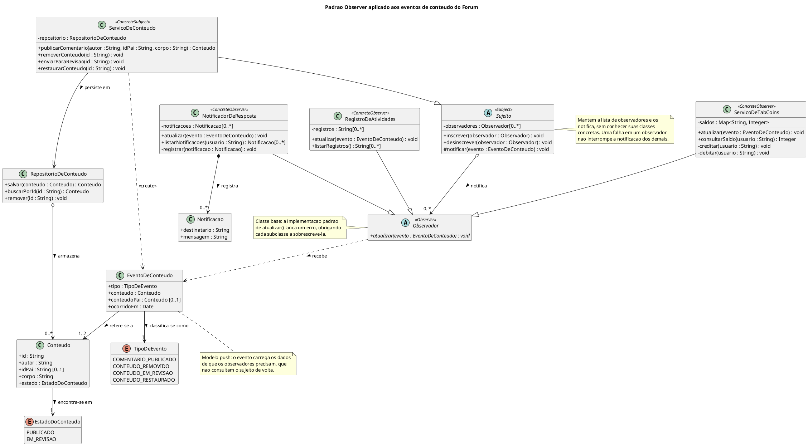

# 2. Modelagem

## 1. Introdução

Esta página apresenta a modelagem, na notação UML, do padrão comportamental GoF **Observer** aplicado aos eventos de conteúdo do Projeto Fórum. A modelagem é composta por um **Diagrama de Classes**, que descreve a estrutura dos participantes do padrão, e por um **Diagrama de Sequência**, que descreve como esses participantes colaboram em tempo de execução.

Os diagramas foram elaborados em PlantUML, de modo que o código-fonte de cada diagrama é o próprio artefato versionado no repositório (ver [Iniciativas Extras](/Base/1.3.IniciativasExtras.md)).

A modelagem corresponde a uma implementação demonstrativa, independente do sistema real do TabNews. Ela não representa uma integração já realizada à aplicação principal.

## 2. Contexto e rastreabilidade com a Entrega 02

Na Entrega 02, a SubEquipe_03 modelou o fluxo de [publicação de um comentário](https://unbarqdsw2026-2-turma01.github.io/RepositorioTemplateEntrega2-TabNews-Forum/#/Base/Relatórios/SubEquipe_03/ModelagemDinamica) na Página da postagem. No Diagrama de Sequência daquela entrega, o `ContentService`, após persistir o comentário, chama diretamente o `TabCoinsService` para creditar o autor:

```text
CS -> TC : creditarPorPublicacao(usuario, comentario)
```

No Diagrama de Estados da mesma entrega, a transição de remoção de um conteúdo também dispara uma ação secundária: `remover [autor ou moderador] / debitar créditos`.

Esses dois artefatos revelam o problema que motiva a escolha do padrão: **o serviço responsável pelo conteúdo precisa conhecer cada um dos interessados nos seus eventos.** A cada nova reação a um evento, como notificar o autor de uma publicação que recebeu uma resposta, registrar uma atividade ou atualizar um contador, seria necessário alterar o serviço de conteúdo e acrescentar uma nova dependência a ele. Com isso, o acoplamento cresce e o princípio Aberto/Fechado deixa de ser respeitado.

A mesma entrega antecipa uma dessas novas reações. O [Diagrama de Implantação](https://unbarqdsw2026-2-turma01.github.io/RepositorioTemplateEntrega2-TabNews-Forum/#/Base/Relatórios/SubEquipe_03/ModelagemEstatica) da SubEquipe_03 já previa o nó externo **Serviço de e-mail**, acionado apenas para notificar o autor de um conteúdo quando ele recebe uma resposta. Aquele diagrama situa o nó no ambiente de execução, mas não define qual componente decide quando acioná-lo. Nesta modelagem, essa decisão cabe ao `NotificadorDeResposta`, que reage ao evento de publicação sem que o serviço de conteúdo precise conhecê-lo. Na demonstração, a notificação é apenas registrada em memória; em um sistema real, seria esse observador que acionaria o serviço de e-mail.

O padrão Observer resolve esse problema ao definir uma dependência um-para-muitos entre objetos, de modo que, quando um objeto muda de estado, todos os seus dependentes são notificados e atualizados automaticamente (GAMMA et al., 2000). O serviço de conteúdo passa a apenas **anunciar** que um evento ocorreu, sem saber quem reage a ele.

| Elemento da Entrega 02 | Elemento desta modelagem | Papel no Observer |
|---|---|---|
| `ContentService` | `ServicoDeConteudo` | Sujeito concreto |
| `TabCoinsService` | `ServicoDeTabCoins` | Observador concreto |
| `ContentRepository` | `RepositorioDeConteudo` | Colaborador do sujeito (fora do padrão) |
| Nó externo `Serviço de e-mail` do [Diagrama de Implantação](https://unbarqdsw2026-2-turma01.github.io/RepositorioTemplateEntrega2-TabNews-Forum/#/Base/Relatórios/SubEquipe_03/ModelagemEstatica), acionado para notificar o autor de uma resposta | `NotificadorDeResposta` | Observador concreto |
| — (nova funcionalidade) | `RegistroDeAtividades` | Observador concreto |
| Chamada direta `creditarPorPublicacao` | `notificar(evento)` → `atualizar(evento)` | Protocolo de notificação |

<p align="center">Tabela 1: Correspondência entre os artefatos da Entrega 02 e esta modelagem.<br>Autoria: Caio Alexandre; linha do `RegistroDeAtividades`: Guilherme Moura; linha do Serviço de e-mail: Leonardo Bonetti.</p>

## 3. Diagrama de Classes UML



<p align="center">Figura 1: Diagrama de Classes do padrão Observer aplicado aos eventos de conteúdo. Fonte: SubEquipe_03 (2026).<br>Elaboração: Caio Alexandre. Atualizações: Guilherme Moura e Leonardo Bonetti.</p>

### 3.1 Interpretação do diagrama

Os estereótipos `<<Subject>>`, `<<Observer>>`, `<<ConcreteSubject>>` e `<<ConcreteObserver>>` indicam o papel que cada classe desempenha na estrutura canônica do padrão descrita por Gamma et al. (2000). Isso permite identificar o padrão diretamente no diagrama, independentemente dos nomes do domínio.

- **`Sujeito`**: classe abstrata que mantém a coleção de observadores e implementa as operações `inscrever`, `desinscrever` e `notificar`. A operação `notificar` é protegida (`#`), pois somente o próprio sujeito decide quando um evento ocorreu. O relacionamento com `Observador` é uma **agregação** com multiplicidade `0..*`: o sujeito referencia os observadores, mas não controla o ciclo de vida deles.
- **`Observador`**: classe abstrata com a única operação abstrata `atualizar(evento)`, representada em itálico no diagrama. É a abstração da qual o sujeito depende, e é isso que o desacopla dos observadores concretos. Como o JavaScript não possui interfaces, a classe base garante o contrato em tempo de execução: sua implementação padrão de `atualizar` lança um erro, de modo que uma subclasse que esqueça de sobrescrevê-la falha de forma explícita.
- **`ServicoDeConteudo`**: sujeito concreto. Herda o mecanismo de inscrição de `Sujeito` e, após publicar, remover, enviar para revisão ou restaurar um conteúdo, cria um `EventoDeConteudo` e o repassa a `notificar`. Ele depende de `RepositorioDeConteudo` para persistência, mas não possui nenhuma referência a `ServicoDeTabCoins`, `NotificadorDeResposta` ou `RegistroDeAtividades`. Antes de notificar a revisão ou a restauração, verifica e atualiza o `estado` do conteúdo, de modo que só um conteúdo publicado vai para revisão e só um conteúdo em revisão é restaurado.
- **`ServicoDeTabCoins`**: observador concreto, subclasse de `Observador`, que credita TabCoins ao autor quando um comentário é publicado ou restaurado e os debita quando um conteúdo é enviado para revisão ou removido, reproduzindo as regras modeladas na Entrega 02. Um conteúdo removido enquanto está em revisão não é debitado de novo, porque os créditos já foram suspensos na entrada em revisão. As operações privadas `creditar` e `debitar` aparecem como automensagens no Diagrama de Sequência.
- **`NotificadorDeResposta`**: observador concreto, subclasse de `Observador`, que gera uma `Notificacao` para o autor do conteúdo pai quando este recebe uma resposta de outro usuário. A relação com `Notificacao` é uma **composição**, pois as notificações existem apenas no contexto do notificador. A operação privada `registrar` corresponde à automensagem de mesmo nome no Diagrama de Sequência.
- **`RegistroDeAtividades`** : observador concreto, subclasse de Observador, que atua como um mecanismo de auditoria. Diferente dos demais, ele reage a todos os tipos de eventos, gravando um histórico sequencial das operações do sistema.
- **`Conteudo`** e **`EstadoDoConteudo`**: o conteúdo guarda o estado em que se encontra, com os valores `PUBLICADO` e `EM_REVISAO`, que correspondem aos estados Publicado e Em revisão do Diagrama de Estados da Entrega 02. O estado Removido não é representado como valor, pois o conteúdo removido deixa de existir no repositório.
- **`EventoDeConteudo`** e **`TipoDeEvento`**: objeto de dados que trafega do sujeito para os observadores. O campo `conteudoPai` é opcional (`[0..1]`), já que só se aplica a comentários. Por isso, a associação com `Conteudo` tem multiplicidade `1..2`.

As associações são rotuladas com **verbos**, e o símbolo `>` indica o sentido de leitura: o `Sujeito` *notifica* os observadores, o `ServicoDeConteudo` *persiste em* um `RepositorioDeConteudo`, que *armazena* os conteúdos, e o `EventoDeConteudo` *refere-se a* um ou dois conteúdos e *classifica-se como* um `TipoDeEvento`. Assim, cada relação pode ser lida como uma frase do domínio, e o nome do papel continua visível no atributo correspondente da classe de origem (por exemplo, `- observadores` em `Sujeito`).

## 4. Diagrama de Sequência UML

```plantuml
@startuml
title Notificacao dos observadores a partir dos eventos de conteudo

participant "Cliente\n(index.js)" as C
participant "conteudos :\nServicoDeConteudo" as SC
participant "repositorio :\nRepositorioDeConteudo" as REPO
participant "tabcoins :\nServicoDeTabCoins" as TC
participant "notificador :\nNotificadorDeResposta" as NR
participant "auditoria :\nRegistroDeAtividades" as RA

== Configuracao (composicao dos objetos) ==

C -> SC : inscrever(tabcoins)
C -> SC : inscrever(notificador)
C -> SC : inscrever(auditoria)

== Publicacao de comentario ==

C -> SC : publicarComentario(autor, idPai, corpo)
activate SC
SC -> REPO : buscarPorId(idPai)
activate REPO
REPO --> SC : conteudoPai
deactivate REPO
SC -> REPO : salvar(comentario)
activate REPO
REPO --> SC : comentario
deactivate REPO

SC -> SC : notificar(evento)\n[tipo = COMENTARIO_PUBLICADO]
activate SC

loop para cada observador inscrito, na ordem de inscricao
  SC -> TC : atualizar(evento)
  activate TC
  TC -> TC : creditar(comentario.autor)
  TC --> SC
  deactivate TC

  SC -> NR : atualizar(evento)
  activate NR
  alt conteudoPai.autor != comentario.autor
    NR -> NR : registrar(Notificacao para conteudoPai.autor)
  else resposta ao proprio conteudo
    NR -> NR : ignorar evento
  end
  NR --> SC
  deactivate NR

  SC -> RA : atualizar(evento)
  activate RA
  RA -> RA : gravar registro do evento
  RA --> SC
  deactivate RA
end

deactivate SC
SC --> C : comentario
deactivate SC

== Moderacao: envio para revisao e restauracao ==

C -> SC : enviarParaRevisao(id)
activate SC
SC -> REPO : buscarPorId(id)
activate REPO
REPO --> SC : conteudo
deactivate REPO
note right of SC
  Exige conteudo.estado = PUBLICADO;
  caso contrario, lanca um erro
  e nao notifica.
end note
SC -> REPO : salvar(conteudo)\n[estado = EM_REVISAO]
SC -> SC : notificar(evento)\n[tipo = CONTEUDO_EM_REVISAO]
activate SC
loop para cada observador inscrito, na ordem de inscricao
  SC -> TC : atualizar(evento)
  activate TC
  TC -> TC : debitar(conteudo.autor)
  TC --> SC
  deactivate TC
  SC -> NR : atualizar(evento)
  activate NR
  NR -> NR : ignorar evento\n(tipo nao tratado)
  NR --> SC
  deactivate NR
  SC -> RA : atualizar(evento)
  activate RA
  RA -> RA : gravar registro do evento
  RA --> SC
  deactivate RA
end
deactivate SC
SC --> C
deactivate SC

C -> SC : restaurarConteudo(id)
activate SC
note right of SC
  Exige conteudo.estado = EM_REVISAO;
  busca identica a do envio para revisao.
end note
SC -> REPO : salvar(conteudo)\n[estado = PUBLICADO]
SC -> SC : notificar(evento)\n[tipo = CONTEUDO_RESTAURADO]
activate SC
loop para cada observador inscrito, na ordem de inscricao
  SC -> TC : atualizar(evento)
  activate TC
  TC -> TC : creditar(conteudo.autor)
  TC --> SC
  deactivate TC
  SC -> NR : atualizar(evento)
  activate NR
  NR -> NR : ignorar evento\n(tipo nao tratado)
  NR --> SC
  deactivate NR
  SC -> RA : atualizar(evento)
  activate RA
  RA -> RA : gravar registro do evento
  RA --> SC
  deactivate RA
end
deactivate SC
SC --> C
deactivate SC

== Remocao de conteudo ==

C -> SC : removerConteudo(id)
activate SC
SC -> REPO : buscarPorId(id)
activate REPO
REPO --> SC : conteudo
deactivate REPO
SC -> REPO : remover(id)

SC -> SC : notificar(evento)\n[tipo = CONTEUDO_REMOVIDO]
activate SC
loop para cada observador inscrito, na ordem de inscricao
  SC -> TC : atualizar(evento)
  activate TC
  alt conteudo.estado = PUBLICADO
    TC -> TC : debitar(conteudo.autor)
  else conteudo em revisao
    TC -> TC : ignorar evento\n(creditos ja suspensos)
  end
  TC --> SC
  deactivate TC

  SC -> NR : atualizar(evento)
  activate NR
  NR -> NR : ignorar evento\n(tipo nao tratado)
  NR --> SC
  deactivate NR

  SC -> RA : atualizar(evento)
  activate RA
  RA -> RA : gravar registro do evento
  RA --> SC
  deactivate RA
end
deactivate SC
SC --> C
deactivate SC

== Desinscricao de observador ==

C -> SC : desinscrever(notificador)
note right of C
  Ex.: o servico de notificacoes
  e desativado para manutencao.
end note

C -> SC : publicarComentario(autor, idPai, corpo)
activate SC
note right of SC
  Busca e persistencia identicas
  as da publicacao anterior
end note
SC -> SC : notificar(evento)\n[tipo = COMENTARIO_PUBLICADO]
activate SC
loop para cada observador inscrito (tabcoins e auditoria)
  SC -> TC : atualizar(evento)
  activate TC
  TC -> TC : creditar(comentario.autor)
  TC --> SC
  deactivate TC
  SC -> RA : atualizar(evento)
  activate RA
  RA -> RA : gravar registro do evento
  RA --> SC
  deactivate RA
end
deactivate SC
SC --> C : comentario
deactivate SC
@enduml
```



<p align="center">Figura 2: Diagrama de Sequência da notificação dos observadores. Fonte: SubEquipe_03 (2026).<br>Elaboração: Caio Alexandre. Atualizações: Guilherme Moura e Leonardo Bonetti.</p>

### 4.1 Descrição da sequência

O diagrama é dividido em cinco etapas.

1. **Configuração.** O cliente, que na demonstração é o arquivo `index.js`, cria os objetos e inscreve os observadores no sujeito. É o único ponto da solução que conhece todas as classes concretas. Adicionar um novo observador exige alterar apenas essa etapa.
2. **Publicação de comentário.** O `ServicoDeConteudo` busca o conteúdo pai, persiste o comentário e chama `notificar` com um evento do tipo `COMENTARIO_PUBLICADO`. O fragmento `loop` representa a iteração sobre a lista de observadores. O `ServicoDeTabCoins` credita o autor, o `NotificadorDeResposta` usa o fragmento `alt` para decidir se gera a notificação (um usuário que responde ao próprio conteúdo não é notificado) e o `RegistroDeAtividades` grava a operação no log. Os três são chamados dentro do mesmo laço, na ordem de inscrição: o sujeito não chama nenhum deles diretamente.
3. **Moderação (Revisão e Restauração).** O cliente simula o envio do conteúdo para revisão e sua posterior restauração. Antes de notificar, o `ServicoDeConteudo` verifica e atualiza o `estado` do conteúdo: só um conteúdo publicado vai para revisão e só um conteúdo em revisão é restaurado, como no Diagrama de Estados da Entrega 02. Em seguida, emite os eventos `CONTEUDO_EM_REVISAO` e `CONTEUDO_RESTAURADO`. O `ServicoDeTabCoins` suspende e depois devolve os créditos, o `NotificadorDeResposta` ignora os dois eventos e o log de auditoria registra ambos os movimentos.
4. **Remoção de conteúdo.** O mesmo protocolo é reutilizado para o evento `CONTEUDO_REMOVIDO`. O `ServicoDeTabCoins` debita o autor, exceto quando o conteúdo estava em revisão, caso em que os créditos já foram suspensos; o `NotificadorDeResposta` ignora o evento por não tratar esse tipo; e o `RegistroDeAtividades` grava a remoção. Essa etapa evidencia que **cada observador decide a quais eventos reage**, sem que o sujeito precise filtrar os destinatários.
5. **Desinscrição de observador.** O cliente remove o `NotificadorDeResposta` da lista de observadores, como aconteceria, por exemplo, se o serviço de notificações fosse desativado para manutenção. Na publicação seguinte, apenas o `ServicoDeTabCoins` e o `RegistroDeAtividades` são notificados, e o `ServicoDeConteudo` permanece inalterado. Essa etapa evidencia que **as relações entre sujeito e observadores são estabelecidas em tempo de execução**, o que caracteriza o escopo de objeto do padrão. A desinscrição atua sobre o observador como um todo; preferências individuais de cada usuário, como silenciar as notificações de uma publicação específica, seriam responsabilidade do próprio `NotificadorDeResposta` e estão fora do escopo da demonstração.

A comparação com o Diagrama de Sequência da Entrega 02 mostra a mudança estrutural: a mensagem direta `creditarPorPublicacao` do serviço de conteúdo para o serviço de TabCoins foi substituída pela mensagem genérica `atualizar(evento)`, enviada a um destinatário que o sujeito conhece apenas pela abstração `Observador`.

## 5. Regras modeladas

| Identificador | Regra | Componente responsável | Origem |
|---|---|---|---|
| RN01 | A publicação de um comentário credita TabCoins ao seu autor. | `ServicoDeTabCoins` | Diagrama de Sequência da Entrega 02 |
| RN02 | A remoção de um conteúdo debita TabCoins do seu autor. | `ServicoDeTabCoins` | Diagrama de Estados da Entrega 02 |
| RN03 | O autor de um conteúdo é notificado quando outro usuário o responde. | `NotificadorDeResposta` | Diagrama de Implantação da Entrega 02 (nó Serviço de e-mail), inspirado nas notificações do TabNews |
| RN04 | Um usuário que responde ao próprio conteúdo não é notificado. | `NotificadorDeResposta` | Decisão da SubEquipe_03 |
| RN05 | O sujeito não conhece as classes concretas dos observadores. | `Sujeito` / `ServicoDeConteudo` | Estrutura do padrão Observer |
| RN06 | A falha de um observador não impede a notificação dos demais. | `Sujeito` | Decisão da SubEquipe_03 |
| RN07 | Todas as mudanças de estado do conteúdo (publicação, remoção, revisão e restauração) são gravadas em um histórico sequencial. | `RegistroDeAtividades` | Decisão da SubEquipe_03 (Log de Auditoria) |
| RN08 | Só um conteúdo publicado pode ser enviado para revisão, o que suspende os créditos do autor; só um conteúdo em revisão pode ser restaurado, o que os devolve; e a remoção de um conteúdo em revisão não debita os créditos de novo. | `ServicoDeConteudo` / `ServicoDeTabCoins` | Diagrama de Estados da Entrega 02 |

<p align="center">Tabela 2: Regras representadas na modelagem.<br>Autoria: RN01–RN06, Caio Alexandre; RN07, Guilherme Moura; RN08 e origem da RN03, Leonardo Bonetti.</p>

## 6. Decisões de modelagem e senso crítico

**Modelo *push* em vez de *pull*.** Gamma et al. (2000) descrevem duas variações: no modelo *push*, o sujeito envia ao observador os dados detalhados da mudança; no modelo *pull*, envia apenas um aviso e o observador consulta o sujeito. Foi adotado o modelo *push*, com o `EventoDeConteudo`, porque os dois observadores precisam de dados diferentes (o autor do comentário e o autor do conteúdo pai), e o *pull* obrigaria cada observador a conhecer a interface do `ServicoDeConteudo`, reintroduzindo o acoplamento que o padrão busca eliminar. A contrapartida é que o evento precisa carregar dados suficientes para todos os observadores, inclusive campos que alguns deles não utilizam, como `conteudoPai` para o `ServicoDeTabCoins`.

No contexto do Fórum, o modelo *push* traz três consequências práticas. Primeiro, o `EventoDeConteudo` se torna um contrato compartilhado por todos os observadores: acrescentar um campo para atender a um novo observador altera o objeto que todos recebem, ainda que os demais o ignorem. Segundo, o evento carrega uma referência ao próprio `Conteudo`, e não uma cópia; é isso que permite ao `ServicoDeTabCoins` consultar o `estado` do conteúdo removido para decidir se debita o autor (RN08) sem consultar o sujeito. O evento é congelado, mas o congelamento é raso, de modo que um observador poderia alterar o conteúdo e afetar os seguintes; a solução evita isso por convenção, já que nenhum observador modifica o conteúdo recebido. Terceiro, como os dados chegam prontos, cada observador pode ser testado isoladamente, apenas com eventos construídos para o teste, o que é explorado na suíte de testes automatizados.

**`Sujeito` e `Observador` como classes abstratas.** O mecanismo de inscrição é idêntico para qualquer sujeito, por isso foi colocado em uma superclasse reutilizável. O observador não compartilha implementação, apenas o contrato `atualizar`, e em uma linguagem com tipagem estática seria naturalmente uma interface. Como a implementação é em JavaScript, que não possui interfaces, foram consideradas duas alternativas: tratar o contrato como uma convenção, em que qualquer objeto com um método `atualizar` serve como observador, ou representá-lo por uma classe base cujo método `atualizar` lança um erro se não for sobrescrito. Optou-se pela classe base porque ela **mantém o código fiel ao diagrama**, torna explícito no código quem desempenha o papel de observador (`extends Observador`) e transforma um observador mal implementado em um erro claro, em vez de uma falha silenciosa no momento da notificação. A contrapartida é a dependência de herança: um objeto que já estende outra classe não pode ser observador sem uma adaptação.

**Um único método `atualizar` com o tipo do evento.** Uma alternativa seria oferecer métodos específicos, como `aoPublicarComentario` e `aoRemoverConteudo`. Essa abordagem tornaria explícitos os eventos suportados, mas obrigaria todo observador a implementar todos os métodos e exigiria alterar a interface a cada novo tipo de evento. O método único mantém a interface estável, ao custo de transferir para cada observador a responsabilidade de filtrar os tipos que lhe interessam.

**Isolamento de falhas (RN06).** Em uma notificação síncrona, uma exceção lançada por um observador interromperia o laço e impediria os observadores seguintes de serem notificados. A modelagem estabelece que o sujeito isola cada chamada a `atualizar`, para que uma falha no envio de uma notificação, por exemplo, não impeça o crédito de TabCoins.

**Limitações reconhecidas.** A notificação é **síncrona** e executada na ordem de inscrição. Em um sistema real, a ordem dos observadores não deveria ser uma premissa, e operações lentas, como o envio de e-mails, poderiam ser deslocadas para uma fila assíncrona. Essa é a solução amplamente adotada no mercado: em vez de chamar os observadores diretamente, o `ServicoDeConteudo` publicaria o evento em um intermediário, como um *exchange* do RabbitMQ ou um canal do *Pub/Sub* do Redis, e cada observador passaria a ser um consumidor independente, possivelmente em outro processo. A estrutura de papéis desta modelagem se manteria, com o intermediário assumindo a responsabilidade de entregar os eventos (ver a [distinção entre Observer e publish/subscribe](/Base/Relatórios/SubEquipe03/padrões-gof-comportamentais.md?id=_61-adoção-do-padrão-no-desenvolvimento-de-software)). Além disso, as atualizações em cascata e o fluxo de controle menos explícito são desvantagens conhecidas do padrão: ao ler apenas o `ServicoDeConteudo`, não é possível saber quais efeitos uma publicação produz. Por isso, o Diagrama de Sequência é um complemento necessário ao Diagrama de Classes. Esses aspectos foram mantidos fora do escopo para preservar a proporcionalidade da solução ao objetivo acadêmico.

### 6.1 Comparação com a implementação de referência

Como apresentado em [Padrões GoF Comportamentais](/Base/Relatórios/SubEquipe03/padrões-gof-comportamentais.md), Filipe Deschamps, criador do TabNews, aplicou o Observer no [código-fonte](https://github.com/filipedeschamps/meu-primeiro-jogo-multiplayer) da série *Primeiro Jogo Multiplayer*. A comparação com essa implementação ajuda a separar o que é essencial ao padrão do que é escolha de cada solução.

| Aspecto | Jogo de Filipe Deschamps | Esta modelagem |
|---|---|---|
| Coleção de observadores | `state.observers` / `observers` | `Sujeito.observadores` |
| Inscrição | `subscribe(observerFunction)` | `inscrever(observador)` |
| Desinscrição | Não implementada | `desinscrever(observador)` |
| Notificação | `notifyAll(command)` | `notificar(evento)` |
| Representação do observador | Função | Subclasse de `Observador` com o método `atualizar` |
| Dados da notificação | Objeto `command` com o campo `type` | `EventoDeConteudo` com o campo `tipo` |
| Falha em um observador | Interrompe a notificação dos seguintes | Isolada; os demais continuam sendo notificados (RN06) |

<p align="center">Tabela 3: Comparação entre a implementação de referência e esta modelagem.<br>Autoria: Caio Alexandre.</p>

Os pontos de **convergência** reforçam decisões desta modelagem. As duas soluções adotam o modelo *push*, com um objeto de dados que carrega o tipo do evento, e um único ponto de entrada no observador, que decide como reagir a cada tipo. No jogo, o mesmo `notifyAll` transporta comandos como `move-player` e `add-player`, e cada observador trata os tipos que lhe interessam, exatamente como o `NotificadorDeResposta` ignora o evento `CONTEUDO_REMOVIDO`.

As **divergências** decorrem de objetivos diferentes:

- **Funções em vez de classes.** No jogo, um observador é qualquer função inscrita, o que é idiomático em JavaScript e elimina a necessidade de uma hierarquia de classes. Esta modelagem utiliza classes porque seu objetivo é tornar visível cada participante do padrão no Diagrama de Classes, com seus estereótipos. Reconhece-se que a versão com funções é mais enxuta; a escolha aqui privilegia a correspondência com a estrutura canônica do GoF e com a notação UML.
- **Desinscrição.** O jogo não precisa remover observadores durante a execução. Esta modelagem inclui `desinscrever`, prevista pelo GoF, e a exercita na quarta etapa do Diagrama de Sequência.
- **Isolamento de falhas.** No `notifyAll` do jogo, uma exceção em um observador interrompe o laço. Em um jogo didático, essa simplificação é razoável; em um fórum, uma falha no envio de notificações não deveria impedir o crédito de TabCoins, o que motivou a regra RN06.

## 7. Correspondência entre modelagem e implementação

| Elemento da modelagem | Arquivo | Responsabilidade |
|---|---|---|
| `Sujeito` | [`src/Sujeito.js`](https://github.com/UnBArqDsw2026-2-Turma01/RepositorioTemplateEntrega3-TabNews-Forum/blob/main/docs/Base/Relat%C3%B3rios/SubEquipe03/src/Sujeito.js) | Inscrição, desinscrição e notificação dos observadores, com isolamento de falhas (RN06). |
| `Observador` | [`src/Observador.js`](https://github.com/UnBArqDsw2026-2-Turma01/RepositorioTemplateEntrega3-TabNews-Forum/blob/main/docs/Base/Relat%C3%B3rios/SubEquipe03/src/Observador.js) | Classe base cuja implementação padrão de `atualizar` lança um erro, obrigando as subclasses a sobrescrevê-la. |
| `ServicoDeConteudo` | [`src/ServicoDeConteudo.js`](https://github.com/UnBArqDsw2026-2-Turma01/RepositorioTemplateEntrega3-TabNews-Forum/blob/main/docs/Base/Relat%C3%B3rios/SubEquipe03/src/ServicoDeConteudo.js) | Publicação, remoção, envio para revisão e restauração de conteúdos; emissão dos eventos. |
| `ServicoDeTabCoins` | [`src/ServicoDeTabCoins.js`](https://github.com/UnBArqDsw2026-2-Turma01/RepositorioTemplateEntrega3-TabNews-Forum/blob/main/docs/Base/Relat%C3%B3rios/SubEquipe03/src/ServicoDeTabCoins.js) | Crédito e débito de TabCoins. |
| `NotificadorDeResposta`, `Notificacao` | [`src/NotificadorDeResposta.js`](https://github.com/UnBArqDsw2026-2-Turma01/RepositorioTemplateEntrega3-TabNews-Forum/blob/main/docs/Base/Relat%C3%B3rios/SubEquipe03/src/NotificadorDeResposta.js) | Notificação do autor do conteúdo respondido; `Notificacao` fica no mesmo arquivo por existir apenas no contexto do notificador. |
| `RegistroDeAtividades` | [`src/RegistroDeAtividades.js`](https://github.com/UnBArqDsw2026-2-Turma01/RepositorioTemplateEntrega3-TabNews-Forum/blob/main/docs/Base/Relat%C3%B3rios/SubEquipe03/src/RegistroDeAtividades.js) | Auditoria e log sequencial de todos os eventos do sistema. |
| `EventoDeConteudo`, `TipoDeEvento` | [`src/EventoDeConteudo.js`](https://github.com/UnBArqDsw2026-2-Turma01/RepositorioTemplateEntrega3-TabNews-Forum/blob/main/docs/Base/Relat%C3%B3rios/SubEquipe03/src/EventoDeConteudo.js) | Dados transportados na notificação. |
| `RepositorioDeConteudo`, `Conteudo` | [`src/RepositorioDeConteudo.js`](https://github.com/UnBArqDsw2026-2-Turma01/RepositorioTemplateEntrega3-TabNews-Forum/blob/main/docs/Base/Relat%C3%B3rios/SubEquipe03/src/RepositorioDeConteudo.js) | Armazenamento em memória dos conteúdos. |
| Cliente | [`src/index.js`](https://github.com/UnBArqDsw2026-2-Turma01/RepositorioTemplateEntrega3-TabNews-Forum/blob/main/docs/Base/Relat%C3%B3rios/SubEquipe03/src/index.js) | Composição dos objetos e demonstração do fluxo. |
| Regras RN01–RN07 | [`test/observer.test.js`](https://github.com/UnBArqDsw2026-2-Turma01/RepositorioTemplateEntrega3-TabNews-Forum/blob/main/docs/Base/Relat%C3%B3rios/SubEquipe03/test/observer.test.js) | Testes automatizados de cada participante e regra. |

<p align="center">Tabela 4: Correspondência entre os elementos da modelagem e os arquivos de código.<br>Autoria: Caio Alexandre definiu os arquivos previstos; Leonardo Bonetti ligou cada elemento ao arquivo real.</p>

Os arquivos listados são a referência para a etapa de [Código](/Base/Relatórios/SubEquipe03/código.md). Qualquer divergência introduzida na implementação deve ser refletida nos diagramas desta página.

## Referências

FOWLER, Martin. **UML Essencial: um breve guia para a linguagem-padrão de modelagem de objetos**. 3. ed. Porto Alegre: Bookman, 2005.

FREEMAN, Eric; ROBSON, Elisabeth. **Use a Cabeça! Padrões de Projetos**. 2. ed. Rio de Janeiro: Alta Books, 2021.

GAMMA, Erich; HELM, Richard; JOHNSON, Ralph; VLISSIDES, John. **Padrões de Projeto: soluções reutilizáveis de software orientado a objetos**. Porto Alegre: Bookman, 2000.

OBJECT MANAGEMENT GROUP. **OMG Unified Modeling Language (OMG UML), Version 2.5.1**. 2017. Disponível em: [https://www.omg.org/spec/UML/2.5.1/PDF](https://www.omg.org/spec/UML/2.5.1/PDF). Acesso em: 14 out. 2026.

PLANTUML. **Class Diagram**. Disponível em: [https://plantuml.com/class-diagram](https://plantuml.com/class-diagram). Acesso em: 14 out. 2026.

PLANTUML. **Sequence Diagram**. Disponível em: [https://plantuml.com/sequence-diagram](https://plantuml.com/sequence-diagram). Acesso em: 14 out. 2026.

REFACTORING.GURU. **Observer**. Disponível em: [https://refactoring.guru/pt-br/design-patterns/observer](https://refactoring.guru/pt-br/design-patterns/observer). Acesso em: 14 out. 2026.

SUBEQUIPE_03. **Modelagem Estática na Notação UML**. Entrega 02 — Projeto Fórum. Disponível em: [https://unbarqdsw2026-2-turma01.github.io/RepositorioTemplateEntrega2-TabNews-Forum/#/Base/Relatórios/SubEquipe_03/ModelagemEstatica](https://unbarqdsw2026-2-turma01.github.io/RepositorioTemplateEntrega2-TabNews-Forum/#/Base/Relatórios/SubEquipe_03/ModelagemEstatica). Acesso em: 17 out. 2026.

SUBEQUIPE_03. **Modelagem Dinâmica na Notação UML**. Entrega 02 — Projeto Fórum. Disponível em: [https://unbarqdsw2026-2-turma01.github.io/RepositorioTemplateEntrega2-TabNews-Forum/#/Base/Relatórios/SubEquipe_03/ModelagemDinamica](https://unbarqdsw2026-2-turma01.github.io/RepositorioTemplateEntrega2-TabNews-Forum/#/Base/Relatórios/SubEquipe_03/ModelagemDinamica). Acesso em: 14 out. 2026.

## Histórico de Versões

| Versão | Data | Descrição | Autor(es) | Revisor(es) | Detalhe da Revisão |
|:------:|:----:|:----------|:----------|:------------|:-------------------|
| 1.0 | 14/10/2026 | Modelagem UML do padrão Observer aplicado aos eventos de conteúdo. | [Caio Alexandre](https://github.com/bitterteriyaki) | [Arthur Fernandes](https://github.com/arthurfernandesj) | Elaboração do Diagrama de Classes e do Diagrama de Sequência em PlantUML, rastreabilidade com a modelagem dinâmica da Entrega 02, regras modeladas, decisões de modelagem com análise crítica e correspondência prevista com a implementação. |
| 1.1 | 14/10/2026 | Adoção de classe base para o `Observador`, cenário de desinscrição e comparação com a implementação de referência. | [Caio Alexandre](https://github.com/bitterteriyaki) | [Arthur Fernandes](https://github.com/arthurfernandesj) | Conversão de `Observador` de interface para classe abstrata, com a justificativa da escolha em JavaScript; inclusão da etapa de desinscrição no Diagrama de Sequência; criação da subseção de comparação com o código da série Primeiro Jogo Multiplayer, de Filipe Deschamps. |
| 1.2 | 14/10/2026 | Relação das limitações da solução com ferramentas de mensageria. | [Caio Alexandre](https://github.com/bitterteriyaki) | [Arthur Fernandes](https://github.com/arthurfernandesj) | Inclusão, nas limitações reconhecidas, da evolução da notificação síncrona para um intermediário de mensagens, como o RabbitMQ ou o Pub/Sub do Redis, com referência à distinção entre Observer e publish/subscribe. |
| 1.3 | 14/10/2026 | Inclusão da documentação do PlantUML nas referências. | [Caio Alexandre](https://github.com/bitterteriyaki) | [Arthur Fernandes](https://github.com/arthurfernandesj) | Inclusão das páginas de referência dos diagramas de classes e de sequência do PlantUML, ferramenta utilizada na elaboração dos diagramas. |
| 1.4 | 16/10/2026 |  Inclusão do observador `RegistroDeAtividades` e alinhamento com a moderação. | [Guilherme Moura](https://github.com/Guilherme-Moura) | [Leonardo Bonetti](https://github.com/LeoFacB) | Atualização do Diagrama de Classes e do Diagrama de Sequência para incluir o log de auditoria e os eventos de revisão/restauração, fechando o ciclo com o Diagrama de Estados da Entrega 02. |
| 1.5 | 17/10/2026 | Associações com verbos, operações privadas e rastreabilidade. | [Leonardo Bonetti](https://github.com/LeoFacB) | [Caio Alexandre](https://github.com/bitterteriyaki) | **Diagrama de Classes:** as associações, antes sem rótulo ou só com o nome do papel (`observadores`, `repositorio`), passaram a ter verbos com sentido de leitura (`notifica >`, `persiste em >`, `armazena >`, `refere-se a >`, `classifica-se como >`, `registra >`); inclusão das operações privadas `creditar`, `debitar` e `registrar`, que já apareciam como automensagens no Diagrama de Sequência.<br>**Rastreabilidade:** ligação do `NotificadorDeResposta` ao nó Serviço de e-mail do Diagrama de Implantação da Entrega 02 (Tabela 1 e origem da RN03); a Tabela 4 passou dos arquivos previstos para os links dos arquivos reais e ganhou a `Notificacao`.<br>**Texto:** consequências do modelo *push* no Fórum, na seção 6. |
| 1.6 | 17/10/2026 | Estado do conteúdo e correção do Diagrama de Sequência. | [Leonardo Bonetti](https://github.com/LeoFacB) | [Caio Alexandre](https://github.com/bitterteriyaki) | **Diagrama de Classes:** inclusão do atributo `estado` em `Conteudo` e do enum `EstadoDoConteudo` (`PUBLICADO`, `EM_REVISAO`), como no Diagrama de Estados da Entrega 02. Sem o estado, o mesmo conteúdo podia ir para revisão ou ser restaurado mais de uma vez, creditando ou debitando TabCoins em duplicidade.<br>**Diagrama de Sequência:** o `RegistroDeAtividades` era chamado diretamente pelo `ServicoDeConteudo`, fora do `notificar`, o que contraria a RN05 (o sujeito não conhece os observadores concretos); a chamada passou para dentro do laço de notificação. A moderação passou a verificar o estado antes de notificar, a remoção ganhou um fragmento `alt` que só debita conteúdo publicado e o `NotificadorDeResposta` voltou às etapas em que ignora o evento.<br>**Regras:** inclusão da RN08 na Tabela 2. |
| 1.7 | 18/10/2026 | Registro dos revisores. | [Leonardo Bonetti](https://github.com/LeoFacB) | [Caio Alexandre](https://github.com/bitterteriyaki) | Registro dos revisores das versões anteriores, conforme as revisões e os merges dos Pull Requests. |
| 1.8 | 19/10/2026 | Autoria das figuras e tabelas. | [Leonardo Bonetti](https://github.com/LeoFacB) |  | Inclusão, nas legendas, dos integrantes que elaboraram cada figura e tabela, e reescrita do detalhe das versões 1.5 e 1.6, separando o que mudou em cada diagrama e por quê, para identificar a contribuição individual na modelagem. |

<p align="center">Tabela 5: Histórico de Versões.</p>
